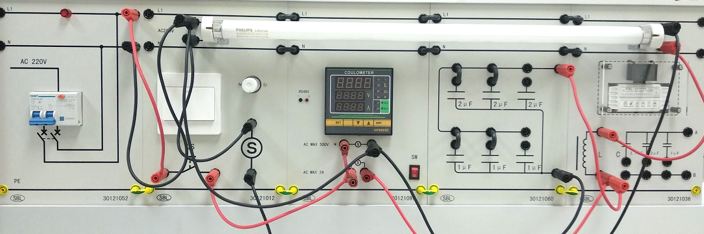
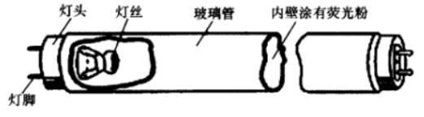
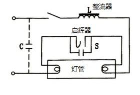

交流电功率因数实验

**Experiment on power factor of AC circuits**

主讲教师

2025.06

浙江大学  物理实验教学中心

1

目录 CONTENTS

实验背景

EXPERIMENT BACKGROUNDS

实验目的

EXPERIMENT OBJECTIVE

实验原理

EXPERIMENT PRINCIPLE

1

2

3

4

5

6

实验装置

EXPERIMENTAL DEVICE

实验内容

EXPERIMENT CONTENT

实验拓展

EXPERIMENTAL EXTENSTION

2

0

预备实验

PRE-EXPERIMENT

根据实验装置，画出电路图

3

1

实验背景

EXPERIMENT BACKGROUNDS

4

1

实验背景

EXPERIMENT BACKGROUNDS

*交流电功率因数：* $cos\Phi$ *=* $\frac{P}{UI}$

提高交流电功率因数的意义：

- 提高用电利用率
- 减少输电线路的损耗
- 改善电压质量
- 降低用电成本

**5**

2

EXPERIMENT OBJECTIVE

实验目的

6

2

实验目的

EXPERIMENT OBJECTIVE

- 理解功率因数的物理意义

- 掌握提高电感性电路功率因素的方法
- 熟悉日光灯的工作原理，掌握测量日光灯功率的方法

7

3

EXPERIMENT  PRINCIPLE

实验原理

8

3

实验原理

EXPERIMENT PRINCIPLE

- **交流电功率因数**

交流电路中的元件有**阻性**负载、**容性**负载、**感性**负载。

- **阻性负载**：靠发热来工作的电器都是阻性负载, 阻性负载的特点是，电流和电压同步变化，相位差为“零度”，工作时会产生热量。
- **容性负载**：电容上电流超前电压90°相位，设想一个电容与电阻串联充电。从充电过程看，总是先有流动电荷（即电流）的积累才有电容上的电压变化，即电流总是超前于电压。
- **感性负载**：像我们平时用的日光灯等家用电器。电感上电流落后感应电压90°相位。

+

*IL*

*IC*

*I*

**R**

**C**

\-

+

**r**

*U*

**L**

\-

**不同负载的交流电路**

**9**

3

实验原理

EXPERIMENT PRINCIPLE

- **交流电功率因数**

如果用*IL* 作为相位的参考方向，下图是它们之间的相位矢量图，由图可见*IL*与*UR* 同相。而纯电感*L*上的电压*UL*比*IL* 超前π/2，合成的*U* 是总电压的幅值，*φ*是*IL* 落后*U* 的相位角 。

+

*IL*

*IC*

*I*

**R**

**C**

\-

+

**r**

*U*

**L**

*P=U·I·cosφ*

\-

**不同负载的交流电路**

****

**10**

3

实验原理

EXPERIMENT PRINCIPLE

- **交流电功率因数**

**φ’**

**φ**

**并联电容的向量分析**

对应提高电感性电路的功率因数，常用的方法就是在靠近感性负载端**并联电容器**，其电路图如左图所示，由相量图可知原感性负载电流滞后于电压φ，当并联电容以后，只要**电容的大小选择得当**，就可以使并联电容以后的总电流小于原来电感中的电流，使**φ’ ＜φ**，使功率因数得到提高。

**11**

3

实验原理

EXPERIMENT PRINCIPLE

- **日光灯管的工作原理**

**日光灯结构**

- 镇流器是一个带铁芯的自感线圈，自感系数很大。
- 启辉器主要是一个充有氖气的小氖泡，里面装有两个电极，一个是静触片，一个是由两个膨胀系数不同的金属制成的U型动触片（双层金属片——当温度升高时，因两层金属片的膨胀系数不同，且内层膨胀系数比外层膨胀系数高，所以动触片在受热后会向外伸展）。

**日光灯电路**

**启辉器**

日光灯电路是日常照明电路中一种较为经济的照明电路，也是一种典型的电感性负载电路，它主要由灯管、镇流器、启辉器组成。

**12**

4

EXPERIMENTAL DEVICE

实验装置

13

4

实验装置

EXPERIMENAL INSTRUMENT

**日光灯开关**

**启辉器**

**日光灯管**

**镇流器**

**空气开关**

**数字表**

**电容**

**14**

5

EXPERIMENT CONTENT

实验内容

15

5

实验内容

EXPERIMENT CONTENT

- **基本实验**

（1）不将电容接入电路，打开总电源开关，开启日光灯开关，观察日光灯启动过程。

（2）用电压表、电流表、功率表测量日光灯电路在额定电压时电路的功率、各电压、电流，并计算功率因数。记录实验数据。

（3）接入电容，并按照电容值从小容量到大容量变化，测量各电流、电压、功率随电容变化的规律，将测量数据记入表中。特别要找出使功率因数为最大值时的电容值。

（4）求出并联电容后的功率因数，填写入表中，进行比较。作cosφ – C散点图。

<table>
  <tr>
    <th rowspan="2"></th>
    <th rowspan="2">未加电容</th>
    <th colspan="7">加电容</th>
  </tr>
  <tr>
    <td>1f</td>
    <td>2f</td>
    <td>3f</td>
    <td>4f</td>
    <td>5f</td>
    <td>6f</td>
    <td>7f</td>
  </tr>
  <tr>
    <td>I/A</td>
    <td></td>
    <td></td>
    <td></td>
    <td></td>
    <td></td>
    <td></td>
    <td></td>
    <td></td>
  </tr>
  <tr>
    <td>U/V</td>
    <td></td>
    <td></td>
    <td></td>
    <td></td>
    <td></td>
    <td></td>
    <td></td>
    <td></td>
  </tr>
  <tr>
    <td>P/W</td>
    <td></td>
    <td></td>
    <td></td>
    <td></td>
    <td></td>
    <td></td>
    <td></td>
    <td></td>
  </tr>
  <tr>
    <td>cos</td>
    <td></td>
    <td></td>
    <td></td>
    <td></td>
    <td></td>
    <td></td>
    <td></td>
    <td></td>
  </tr>
</table>

**16**

5

实验内容

EXPERIMENT CONTENT

- **注意事项**

- 仪器通电前，确保连线正确。
- 不要在开关打开的情况下插拔电容。
- 因为是强电实验，必须谨慎小心，禁止私自接线。

**该实验是强电实验，因此实验中必须谨慎小心。实验连线都已经接好，所以严禁私自接线和打开总电源，必要时请教师检查后方可通电。**

**实验出错的后果是烧表、烧仪器、短路、甚至发生火灾、触电等，请同学们务必做到安全第一！**

**17**

谢谢

2025.06

**交流电功率因数实验**

THANKS FOR LISTENING

18