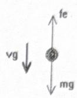
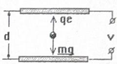
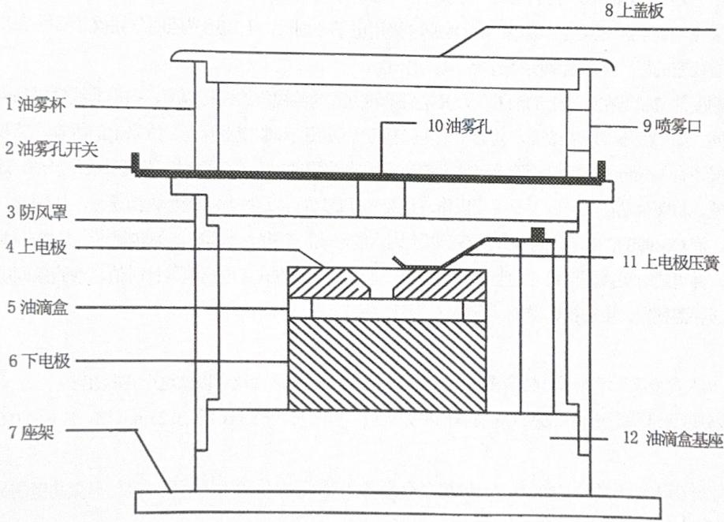
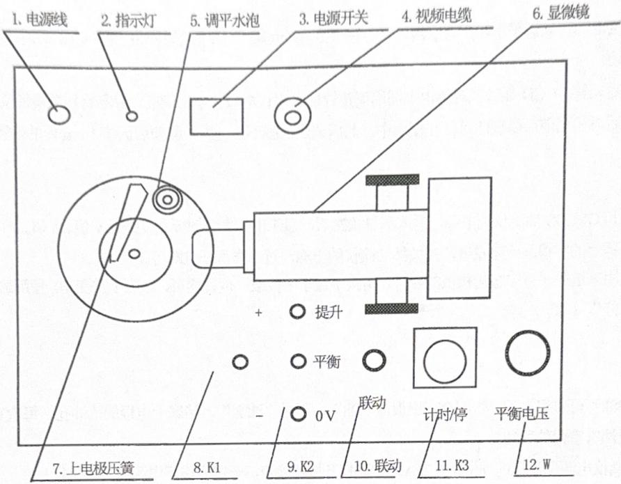
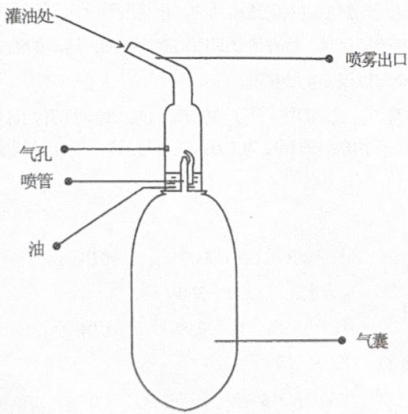

## 第1章 实验目的和原理

## 【实验目的】

OM99S CCD 密立根油滴实验仪是用于验证电荷的不连续性及测量基本电荷电量的物理实验仪器，也是学习了解CCD图象传感器的原理与应用、学习电视显微测量方法的实验仪器。适用于理科、工科及大、中专学校的近代物理实验和普通物理实验的教学。

## 【实验原理】

一个质量为 m，带电量为 q 的油滴处在二块平行极板之间，在平行极板未加电压时，油滴受重力作用而加速下降，由于空气阻力的作用，下降一段距离后，油滴将作匀速运动，速度为 Vg，这时重力与阻力平衡（空气浮力忽略不计），如图 1 所示。根据斯托克斯定律，粘滞阻力为

$$
f _ {r} = 6 \pi a \eta V _ {\mathrm{g}}
$$

  
图1

式中 $\eta$ 是空气的粘滞系数，a是油滴的半径，这时有

$$
6 \pi a \eta V _ {\mathrm{g}} = m g\tag{1}
$$

当在平行极板上加电压 V 时，油滴处在场强为 E 的静电场中，设电场力 qE 与重力相反，如图 2 所示，使油滴受电场力加速上升，由于空气阻力作用，上升一段距离后，油滴所受的空气阻力、重力与电场力达到平衡（空气浮力忽略不计），则油滴将以匀速上升，此时速度为 V e，则有：

  
图2

$$
6 \pi a \eta V _ {g} = q E - m g\tag{2}
$$

又因为 $\mathrm{E} = \mathrm{V} / \mathrm{d}$

(3)

由上述（1）、（2）、（3）式可解出

$$
q = m g \frac {d}{V} \left(\frac {V _ {g} + V _ {e}}{V _ {g}}\right)\tag{4}
$$

为测定油滴所带电荷 q，除应测出 V、d 和速度 V e、V g 外，还需知油滴质量 m，由于空气中悬浮和表面张力作用，可将油滴看作圆球，其质量为

$$
m = 4 / 3 \pi a ^ {3} \rho\tag{5}
$$

式中 $\rho$ 是油滴的密度。

由（1）和（5）式，得油滴的半径

$$
a = \left(\frac {9 \eta V _ {\mathrm{g}}}{2 \rho q}\right) ^ {\frac {1}{2}}\tag{6}
$$

考虑到油滴非常小，空气已不能看成连续媒质，空气的粘滞系数 $\eta$ 应修正为

$$
\eta^ {\prime} = \frac {\eta}{1 + \frac {b}{p a}}\tag{7}
$$

式中 b 为修正常数，p 为空气压强，a 为未经修正过的油滴半径，由于它在修正项中，不必计算得很精确，由（6）式计算就够了.

实验时取油滴匀速下降和匀速上升的距离相等，设都为1，测出油滴匀速下降的时间 $t g$ ，匀速上升的时间 $t e$ ，则

$$
V g = l / t g \quad V e = l / t e\tag{8}
$$

将（5）、（6）、（7）、（8）式代入（4），可得

$$
q = \frac {1 8 \pi}{\sqrt {2 \rho g}} \left(\frac {\eta l}{1 + \frac {b}{p a}}\right) ^ {3 / 2} \frac {d}{V} \left(\frac {1}{t e} + \frac {1}{t g}\right) \left(\frac {1}{t g}\right) ^ {1 / 2}
$$

令

$$
K = \frac {1 8 \pi}{\sqrt {2 \rho g}} \left(\frac {\eta l}{1 + \frac {b}{p a}}\right) ^ {3 / 2} \bullet d
$$

得

$$
q = K \left(\frac {1}{t e} + \frac {1}{t g}\right) \left(\frac {1}{t g}\right) ^ {1 / 2} / V\tag{9}
$$

此式是动态（非平衡）法测油滴电荷的公式。

下面导出静态（平衡）法测油滴电荷的公式。

调节平行极板间的电压，使油滴不动， $V_{e}=0$ ，即 $t_{e}\rightarrow\infty$ ，由（9）式可得

$$
q = K \left(\frac {1}{t g}\right) ^ {3 / 2} \circledast \frac {1}{V}
$$

或者

$$
q = \frac {1 8 \pi}{\sqrt {2 \rho g}} \left[ \frac {\eta l}{t \left(1 + \frac {b}{p a}\right)} \right] ^ {3 / 2} \cdot \frac {d}{V}\tag{10}
$$

上式即为静态法测油滴电荷的公式。

为了求电子电荷 e，对实验测得的各个电荷 q 求最大公约数，就是基本电荷 e 的值，也就是电子电荷 e，也可以测得同一油滴所带电荷的改变量 $\Delta q_{1}$ （可以用紫外线或放射源照射油滴，使它所带电荷改变），这时 $\Delta q_{1}$ 应近似为某一最小单位的整数倍，此最小单位即为基本电荷 e。

## 第2章 仪器特点及结构

## 【仪器特点】

密立根油滴实验是一个经典实验，但老式油滴仪操作十分困难。为此，1993年我们率先在老式油滴仪上加装CCD摄像头获得成功，推出了“组合式”电视显微密立根油滴仪，并向兄弟院校宣传推广及技术转让。（物理实验，1993, No3）

1998 年，我们又成功推出了 “OM98 CCD 微机密立根油滴仪”。CCD 摄像显微镜、照明光路、照明光源、油滴盒、高压电源、微处理器电路等都是最新设计，具有 “组合式” 油滴仪无法比拟的一系列优良性能，是当今最先进的油滴仪。

1999年，进一步完善了工艺的OM99问世。

## 采用多路信息综合显示技术

将数字电压表、数字计时器、油滴像和分划板刻度显示在同一个屏幕上，学生操作直观，教师对实验情况一目了然，也方便了教学操作示范。

采用电子分划板刻度，与其它种类的油滴仪相比：

(1) 采用光学分划板的油滴仪（我们1993年的产品），由于光学分划板方式要用一部分光来照亮分化板，因此观察效果相当于早晨看天上的星星；而OM99S采用电子分划板，无需用光照明分划板（暗场法），相当于晚上看夜空的星星，油滴像明亮清晰，无与伦比。

(2) 将印有刻度的薄膜贴在屏幕上的油滴仪，其电磁偏转方式的监视器的偏转幅度、扫描非线性极易变化，且台台不同。如刻度不能随之改变，就会带来实验精度无法保证和监视器互换、维修上的困难。监视器的球面荧光屏还有3-5mm的厚度，薄膜刻度与油滴像不在荧光屏的同一个平面里，不仅观察不舒适，还会增加视觉误差。将薄膜贴在荧光屏上是手工操作，且荧光屏是球面，这些都会增加人为误差，如倾斜、歪曲、不平等。而OM99S的电子分划板方式不受以上因素的影响，刻度大小自行随偏转幅度、扫描非线性变化而变化，并可随时更换任何尺寸的监视器或投影仪等设备显示方式：电压值、计时值、油滴象同屏显示，可任意送往监视器、电视机、微机、投影仪等多种终端。

## ⑧一机多用

做“布朗运动”实验仅须增加一只高倍显微物镜即可，其它类型的油滴仪难以做这个实验在于：

(1) 分划板刻度无法随时更换；OM99S 备有两种分划板，可随时切换（A 板：0.25mm/格，B 板：0.04mm/格）。

(2) 其它油滴仪难以看到细小的油滴，OM99S 备有高倍显微物镜，实验效果明显（高倍显微物镜需另购）。平衡电压开关可以和计时开关联动

设有联动开关，这样操作方便，实验顺利，可以把精力集中在物理内涵上，当然也可不联动。

## 增强现代科技含量，不减动手训练内容

OM99S 油滴仪采用一系列高新科技的目的只是为了能容易地看到油滴的运动以及仪器稳定可靠不易损坏。但对油滴的操纵、控制仍需要足够的耐心和技巧，细心地进行操作，培养严谨的实验作风。这也是我们坚持不推出容易生产的“智能化油滴仪”的原因所在。

⑥附赠OM99油滴仪实验处理软件，可生成、打印、保存实验数据报告。

## 【仪器结构】

仪器主要由油滴盒、CCD电视显微镜、电路箱、监视器等组成。

油滴盒是个重要部件，加工要求很高，其结构见图3。

从图3上可以看到，上下电极形状与一般油滴仪不同。取消了造成积累误差的“定位台阶”，直接用精加工的平板垫在胶木园环上，这样，极板间的不平行度、极板间的间距误差都可以控制在0.01mm以下。在上电极板中心有一个0.4mm的油雾落入孔，在胶木园环上开有显微镜观察孔和照明孔。

在油滴盘外套上有防风罩，罩上放置一个可取下的油雾杯，杯底中心有一个落油孔及一个档片，用来开关落油孔。在上电极板上方有一个可以左右拨动的压簧，注意，只有将压簧拨向最边位置，方可取出上极板！这一点也与一般油滴仪采用直接抽出上极板的方式不同，为的是保证压簧与电极始终接触良好。

照明灯安装在照明座中间位置，在照明光源和照明光路设计上也与一般油滴仪不同。传统油滴仪的照明光路与显微光路间的夹角为 $120^{\circ}$ ，现根据散射理论，将此夹角增大为 $150^{\circ} \sim 160^{\circ}$ ，油滴像特别明亮。一般油滴仪的照明灯为聚光钨丝灯，很易烧坏，OM99S 油滴仪采用了带聚光的半导体发光器件，使用寿命极长，为半永久性。

CCD 电视显微镜的光学系统是专门设计的，体积小巧，成像质量好。由于 CCD 摄像头与显微镜是整体设计，无须另加连接圈就可方便地装上拆下，使用可靠、稳定、不易损坏 CCD 器件。

  
图3

电路箱体内装有高压产生、测量显示等电路。底部装有三只调平手轮，面板结构见图4。由测量显示电路产生的电子分划板刻度，与CCD摄像头的行扫描严格同步，相当于刻度线是做在CCD器件上的，所以，尽管监视器有大小，或监视器本身有非线性失真，但刻度值是不会变的。

OM99 油滴仪备有两种分划板，标准分划板 A 是 $8 \times 3$ 结构，垂直线视场为 2mm, 分八格，每格值为 0.25mm。为观察油滴的布朗运动，设计了另一种 X、Y 方向各为 15 小格的分划板 B。用随机配备的标准显微物镜时，每格为 0.08mm；换上高倍显微物镜后(选购件)，每格值为 0.04mm，此时，观察效果明显，油滴运动轨迹可以满格。

进入或退出分划板 B 的方法是，按住 “计时 / 停” 按扭大于 5 秒即可切换分划板。

在面板上有两组控制平行极板电压的三按钮开关组， $K_{1}$ 组控制上极板电压的极性， $K_{2}$ 组控制极板上电压的大小。当 $K_{2}$ 组处于中间位置即“平衡”档时，可用电位器调节平衡电压。选择“提升”档时，自动跟踪平衡电压值产生1.5倍平衡电压的提升电压，选择“0V”档时，极板上电压为0V。

为了提高测量精度，OM99S 油滴仪将 K2 的 “平衡”、“0V” 档与计时器的 “计时 / 停” 联动。在 $K_{2}$ 由 “平衡” 打向 “0V”，油滴开始匀速下落的同时开始计时，油滴下落到预定距离时，迅速将 $K_{2}$ 由 “0V” 档打向 “平衡” 档，油滴停止下落的同时停止计时。这样，在屏幕上显示的是油滴实际的运动距离及对应的时间，提供了修正参数。这样可提高测距、测时精度。根据不同的教学要求，也可以不联动。（关闭联动开关即可）

  
图4

由于空气阻力的存在，油滴是先经一段变速运动然后进入匀速运动的。但这变速运动时间非常短，远小于0.01秒，与计时器精度相当。可以看作当油滴自静止开始运动时，油滴是立即作匀速运动的；运动的油滴突然加上原平衡电压时，将立即静止下来。所以，采用联动方式完全可以保证实验精度。

OM99S 油滴仪的计时器采用 “计时 / 停” 方式，即按一下开关，清 0 的同时立即开始计数，再按一下，停止计数，并保存数据。计时器的最小显示为 0.01 秒，但内部计时精度为 $1 \mu s$ ，也就是说，清 0 时刻仅占用 $1 \mu s$ 。

## 【主要技术指标】

平均相对误差: $< 3\%$

平行极板间距离： $5.00\mathrm{mm}\pm 0.01\mathrm{mm}$

极板电压：±DC 0\~700V 可调

提升电压：200V～300V

数字电压表: 0\~999V ± 1V

数字毫秒计：0～99.99秒 ± 0.01秒

电视显微镜：放大倍数 $60 \times$ （标准物镜）， $120 \times$ （选购物镜）

分划板刻度：2种分划板，电子方式，分划板A是8×3结构,垂直线视场分八格，每格值0.25mm

分划板 B, X、Y 方向各为 15 小格,, 每格为 0.08mm

电源：\~220V、50HZ

南京浪博科教仪器有限公司 025-86200631 / 86200632 / 86200633 longbow@vip.sina.com

## 第3章 实验方法与操作

## 【仪器联接】

将OM99S面板上最左边带有Q9插头的电缆线接至监视器后背下部的插座上，然后接上电源即可开始工作。注意，一定要插紧，保证接触良好，否则图象紊乱或只有一些长条纹。

## 【仪器调整】

调节仪器底座上的三只调平手轮，将水泡调平。由于底座空间较小，调手轮时应将手心向上，用中指和无名指夹住手轮调节较为方便。

照明光路不需调整。CCD 显微镜对焦也不需用调焦针插在平行电极孔中来调节，只需将显微镜筒前端和底座前端对齐，然后喷油后再稍稍前后微调即可。在使用中，前后调焦范围不要过大，取前后调焦 1mm 内的油滴较好。

## 【开机】

打开监视器和 OM99S 油滴仪的电源，进入测量状态后，显示出标准分划板刻度线及 v 值、s 值。

如开机后屏幕上的字很乱或字重叠，先关掉油滴仪的电源，过一会再开机即可。

面板上 $K_{1}$ 用来选择平行电极上极板的极性，实验中置于十位或一位置均可，一般不常变动。使用最频繁的是 $K_{2}$ 和W及“计时/停”（ $K_{3}$ ）。

## 【仪器维护】

喷雾器内的油不可装得太满，否则会喷出很多“油”而不是“油雾”，堵塞上电极的落油孔。每次实验完毕应及时揩擦上极板及油雾室内的积油！

OM99S 油滴仪电源保险丝的规格是 0.75A。如需打开机器检查，一定要拔下电源插头再进行！

## 【喷雾器的使用】

  
使用时请注意以下几点：

①用滴管从油瓶里吸取油，由灌油处滴入喷雾器里，不要太多，油的液面3-5毫米高已足够，千万不可高于喷管上口；②喷雾器的喷雾出口比较脆弱，一般将其置于油滴仪的油雾杯圆孔外1-2毫米即可，不必伸入油雾杯内喷油，这样也可

以防止大颗粒油滴堵塞落油孔。

③如果喷雾器里还有剩余的油，不用时将请喷雾器立置（例如放在杯子里），否则油会泄漏至实验台上；

④每学期结束后，将喷雾器里剩余的油倒出，空捏几次，以清空喷雾器；

## 【测量练习】

练习是顺利做好实验的重要一环，包括练习控制油滴运动，练习测量油滴运动时间和练习选择合适的油滴。

1) 选择油滴。选择一颗合适的油滴十分重要。大而亮的油滴必然质量大，所带电荷也多，而匀速下降时间则很短，增大了测量误差和给数据处理带来困难。通常选择平衡电压为 $200 \sim 300 \mathrm{~V}$ ，匀速下落 $1.5 \mathrm{~mm}$ （6 格）的时间在 8-20S 左右的油滴较适宜。喷油后，K2 置“平衡”档,调 W 使极板电压为 $200 \sim 300 \mathrm{~V}$ ，注意几颗缓慢运动、较为清晰明亮的油滴。试将 K2 置“0V”档，观察各颗油滴下落大概的速度，从中选一颗作为测量对象。对于 10 英寸监视器，目视油滴直径在 $0.5 \sim 1 \mathrm{~mm}$ 左右的较适宜。过小的油滴观察困难,布朗运动明显，会引入较大的测量误差。

2) 平衡判断。判断油滴是否平衡要有足够的耐性。用 $K_{2}$ 将油滴移至某条刻度线上, 仔细调节平衡电压, 这样反复操作几次, 经一段时间观察油滴确实不再移动才认为是平衡了。

3）测准油滴上升或下降某段距离所需的时间。一是要统一油滴到达刻度线什么位置才认为油滴已踏线，二是眼睛要平视刻度线，不要有夹角。反复练习几次，使测出的各次时间的离散性较小，并且对油滴的控制比较熟练。

## 【正式测量】

实验方法可选用平衡测量法（静态法）、动态测量法和同一油滴改变电荷法（第三种方法要用到汞灯，选做）。

## 平衡法（静态法）测量。

可将已调平衡的油滴用 $K_{2}$ 控制移到 “起跑” 线上（一般取第 2 格上线），按 K3（计时 / 停），让计时器停止计时（值未必要为 0），然后将 $K_{2}$ 拨向 “0V”，油滴开始匀速下降的同时，计时器开始计时。到 “终点” （一般取第 7 格下线）时迅速将 $K_{2}$ 拨向 “平衡”，油滴立即静止，计时也立即停止，此时电压值和下落时间值显示在屏幕上，进行相应的数据处理即可。

## ②动态法测量。

分别测出加电压时油滴上升的速度和不加电压时油滴下落的速度, 代入相应公式, 求出 e 值, 此时最好将 $K_{2}$ 与 $K_{3}$ 的联动断开。油滴的运动距离一般取 1mm～1.5mm。对某颗油滴重复 5～10 次测量, 选择 10～20 颗油滴, 求得电子电荷的平均值 e 。在每次测量时都要检查和调整平衡电压, 以减小偶然误差和因油滴挥发而使平衡电压发生变化。

## ③同一油滴改变电荷法（非汞灯型可忽略此部分内容）。

在平衡法或动态法的基础上，用汞灯照射目标油滴，使之改变带电量，表现为原有的平衡电压已不能保持油滴的平衡，然后用平衡法或动态法重新测量。具体步骤：当已经将某粒油滴（选择颗粒较大的油滴）调节平衡以后（最好选取在屏幕中央的油滴），按下汞灯按钮不放，维持10至30秒钟。在刚刚按下去的几秒钟内，虽然油滴的带电量还没改变，但已调好的平衡电压受影响而有所降低，这时需要微调节平衡电压将油滴恢复平衡。随着时间的推移，油滴的带电量会发生改变，平衡将被打破，此时松开汞灯按钮，重新调节平衡电压以测量油滴的带电量。

## 第4章 数据处理

【手动计算】

平衡法依据公式为：

$$
q = \frac {1 8 \pi}{\sqrt {2 \rho g}} \left[ \frac {\eta l}{t _ {g} \left(1 + \frac {b}{p a}\right)} \right] ^ {3 / 2} \cdot \frac {d}{V}
$$

式中

$$
a = \sqrt {\frac {9 \eta l}{2 \rho g t _ {g}}}
$$

油的密度

$$
\rho = 9 8 1 k g \bullet m ^ {- 3} (2 0 ^ {\circ} \mathrm{C})
$$

重力加速度

$$
g = 9. 7 9 m \bullet s ^ {- 2} \quad (\text { 南   京 })
$$

空气粘滞系数

$$
\eta = 1. 8 3 \times 1 0 ^ {- 5} k g \bullet m ^ {- 1} \bullet s ^ {- 1}
$$

油滴匀速下降距离

$$
l = 1. 5 \times 1 0 ^ {- 3} m
$$

修正常数

$$
b = 6. 1 7 \times 1 0 ^ {- 6} m \bullet c m H g
$$

大气压强

$$
p = 7 6. 0 \mathrm{cmHg}
$$

平行极板间距离

$$
d = 5. 0 0 \times 1 0 ^ {- 3} m
$$

式中的时间 $t_{g}$ 应为测量数次时间的平均值。实际大气压可由气压表读出。

计算出各油滴的电荷后，求它们的最大公约数，即为基本电荷 e 值。若求最大公约数有困难，可用作图法求 e 值。设实验得到 m 个油滴的带电量分别为 $q_{1}, q_{2}, \cdots, q_{m}$ ，由于电荷的量子化特性，应有 $q_{i} = n_{i} e$ ，此为一直线方程，n 为自变量，q 为因变量，e 为斜率。因此 m 个油滴对应的数据在 $n \sim q$ 坐标中将在同一条过圆点的直线上，若找到满足这一关系的直线，就可用斜率求得 e 值。

将e的实验值与公认值比较，求相对误差。（公认值 $e=1.60\times10^{-19}$ 库仑）

## 【软件计算】

我们专为 OM99S CCD 密立根油滴实验仪配套提供了数据处理软件 OMWIN1.6，适用于 Windows 9X/2000/Me/Xp 等操作系统。只要设定好实验的有关参数，然后依次输入测量数据即可得到结果及相对误差，并可将姓名、学号、日期和实验数据一并打印出来。使用方法详见下文。