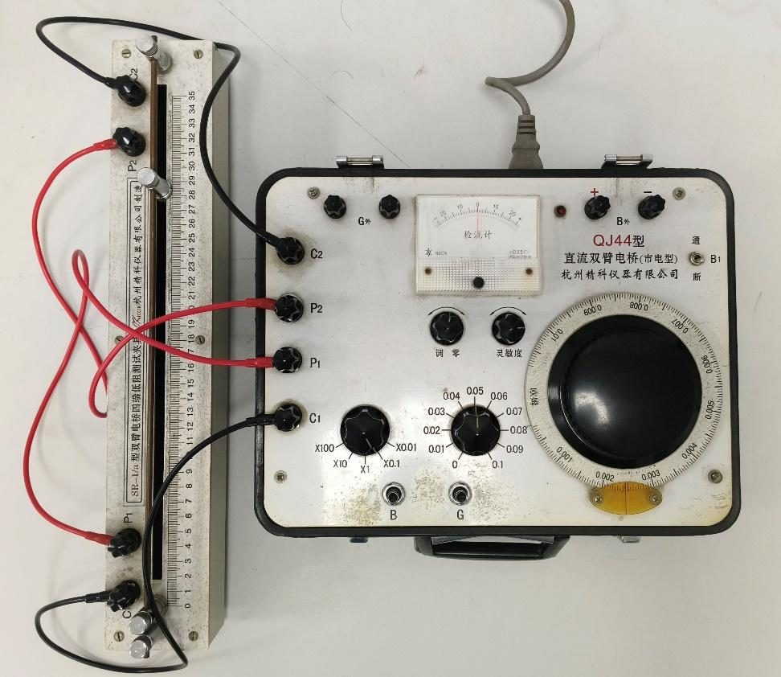
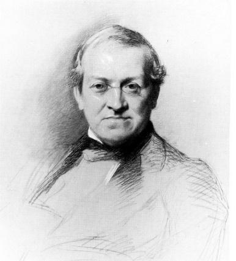
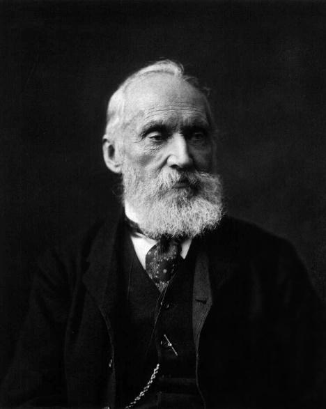
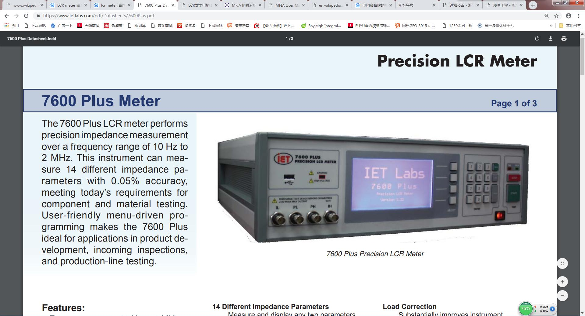
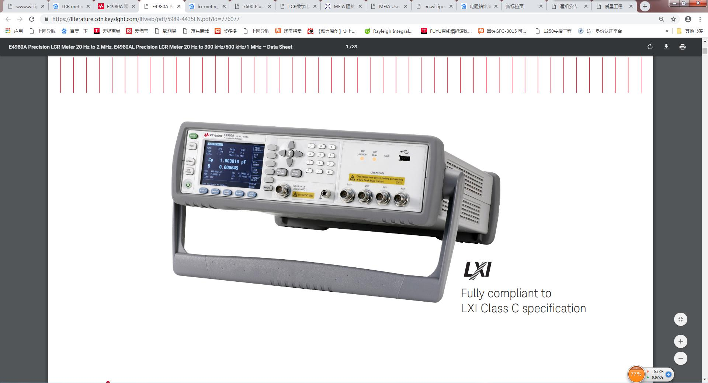
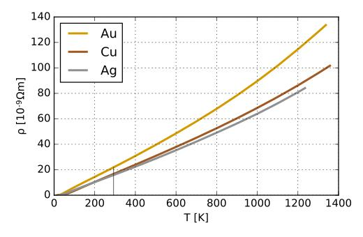
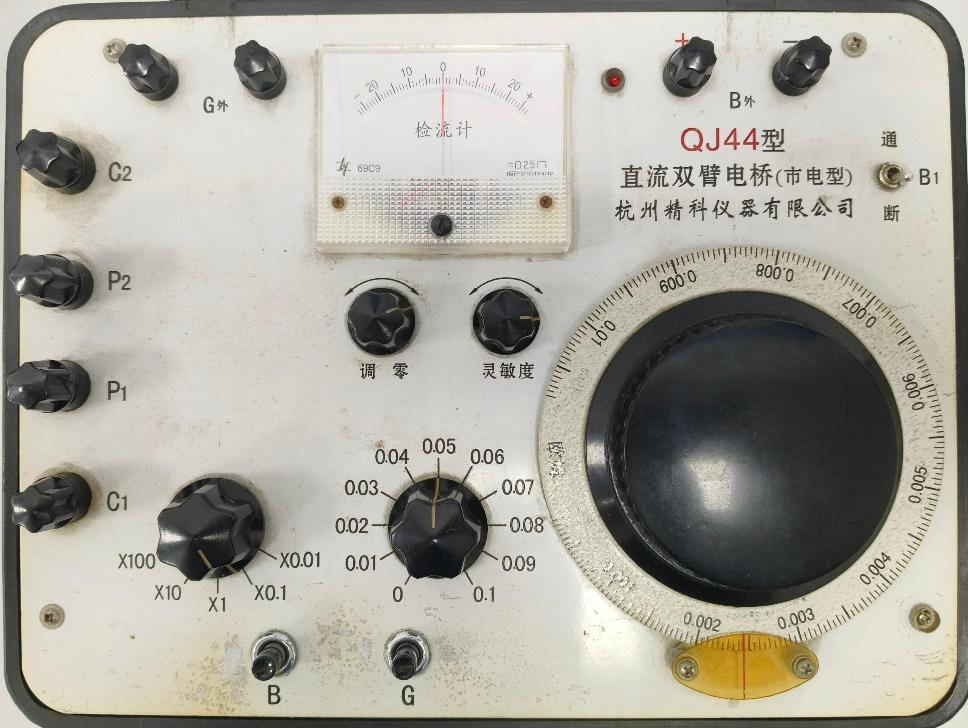
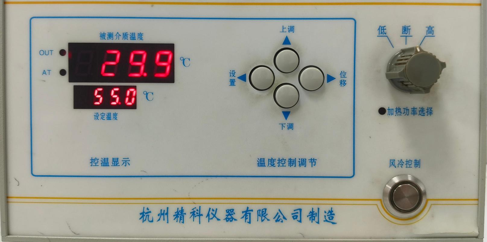

直流双臂电桥

## **Kalvin Double Bridge**

浙江大学  物理实验教学中心

0

预备实验

PREPARATORY EXPERIMENT

## **用直流双臂电桥测量金属导体电阻**

### **实验要求：**

### **1、熟悉双臂电桥按钮功能；**

### **2、根据电路图，接入待测金属导体，选择适当倍率，测量其阻值。**

**2**

1

EXPERIMENT BACKGROUND

实验背景

1

实验背景

EXPERIMENT BACKGROUND

惠斯登

C. Wheatstone

1802-1875

开尔文

W. Thomson

1824-1907

1862年英国的W.汤姆孙在研究利用单臂电桥测量小电阻遇到困难时，发现引起测量产生较大误差的原因是引线电阻和连接点处的接触电阻。这些电阻值可能远大于被测电阻值。因此,他提出了新的桥路，想办法消除或减小接线电阻和接触电阻对测量结果的影响，被称为汤姆孙电桥。后因他晋封为开尔文勋爵，故又称开尔文电桥。

**4**

1

实验背景

EXPERIMENT BACKGROUND

**1843**

**1865**

**1891**

**1912**

**1940s**

**如今**

惠斯登电桥：140微欧

电线电报

开尔文电桥：1微欧

麦克斯韦电桥

维恩电桥

… …

放大器

阻抗分析仪（LCR表）

<table>
  <tr>
    <th>1E-4 – 99.99999E6 $𝛀$</th>
    <th>1.00000E-18 – 999.9999E18 $𝛀$</th>
  </tr>
  <tr>
    <td>1E-17 – 9.999999 F</td>
    <td>1.00000E-18 – 999.9999E18 F</td>
  </tr>
  <tr>
    <td>1E-12 – 99.99999 H</td>
    <td>1.00000E-18 – 999.9999E18 H</td>
  </tr>
</table>

## ***t***

**5**

2

EXPERIMENT OBJECTIVE

实验目的

2

实验目的

EXPERIMENT OBJECTIVE

- 掌握双臂电桥测量低电阻的原理和使用方法
- 了解单臂电桥与双臂电桥的关系和区别

**7**

3

EXPERIMENT  PRINCIPLE

实验原理

3

实验原理

EXPERIMENT PRINCIPLE

接触电阻与导线电阻的影响

*r*1和*r*2代表接触电阻和导线电阻，一般在0.01-1 Ω的数量级。由图可见，当测量电阻时*r*1和*r*2会包含于内，实际测得的阻值为*Rx*+*r*1+*r*2，当*Rx*与*r*1、*r*2同数量级时引入的误差就很大。

*r*1

*Rx*

*r*2

**9**

3

实验原理

EXPERIMENT PRINCIPLE

四端接入法减小误差

为了消除（或减小）接线电阻对测量结果的影响，用四端接入法进行电阻连接。与两端接入法相比，四端接入法“转移”了附加电阻相对于待测电阻的位置。如图所示，C1’P1’P2’C2’是一个完整的低值电阻，其中C1’和C2’称为电流接头，P1’和P2’称为电位接头，介于电位接头间<strong>绿色的部分</strong>才是实测电阻<em>Rx</em>，附加电阻<em>r</em>1、<em>r</em>2已被“转移”到被测电阻之外，而新增的附加电阻<em>r</em>3、<em>r</em>4并不与<em>Rx</em>直接串联，因此不会改变待测电阻的阻值。

P1

P2

C1

*r*1

*r*3

*Rx*

*r*4

*r*2

C2

P1’

C1’

P2’

C2’

**10**

3

实验原理

EXPERIMENT PRINCIPLE

双臂电桥原理

B

C*x*1

*R*1

G

*R*2

P*x*1

*R*3

P*x*2

D

Ps1

*R*4

Ps2

*Rx*

**

*r*

C*x*2

Cs2

*R*s

把采用四端接入法的低电阻接入原惠斯登（单臂）电桥，演变成双臂电桥，其等效电路如左图所示。为了消除附加电阻的影响，分别接入阻值均大于10 的标准电阻*R*3和*R*4，且为考虑电桥平衡时*R*1/*R*2与*R*3/*R*4的差别对测量结果的影响，用阻值小于0.001 的粗导线*r*来连接电阻*Rx*和*R*s。此外，电路中加接一放大电路，用以增加灵敏度，使不平衡电流*I*G通过放大后再由检流计指示。

Cs1

**11**

3

实验原理

EXPERIMENT PRINCIPLE

B

C*x*1

*I*

*R*1

G

*R*2

*I*G

*I*1

P*x*1

Ps1

D

*R*3

*R*4

P*x*2

Ps2

*I*2

*Rx*

*R*s

*r*

*I*3

**

C*x*2

Cs2

当电桥平衡时，检流计指示为零，*I*G=0。这时通过*R*1和*R*2的电流相等，记为*I*1，通过*R*3和*R*4的电流也相等，记为*I*2，忽略附加电阻的影响，根据基尔霍夫定律，有：

Cs1

**12**

3

实验原理

EXPERIMENT PRINCIPLE

B

C*x*1

*I*

*R*1

G

*R*2

*I*G

*I*1

P*x*1

Ps1

D

*R*3

*R*4

P*x*2

Ps2

*I*2

*Rx*

*R*s

*r*

*I*3

**

C*x*2

Cs2

解放程组得：

若在电桥使用过程中始终确保*R*1/*R*2=*R*3/*R*4成立，则上式中第二项为零，公式转化为：

可见，当双臂电桥调节平衡时，由比较臂电阻*R*s和比率臂*R*1/*R*2示数的乘积，便可求得待测低电阻*Rx*的值。

Cs1

**13**

3

实验原理

EXPERIMENT PRINCIPLE

为确保*R*1/*R*2=*R*3/*R*4在电桥使用过程中始终成立，通常将两对比率臂（*R*1/*R*2，*R*3/*R*4）选用双十进制电阻箱。它的基本原理是将两个相同十进制电阻器的转臂连接在同一转轴上，这样在转臂的任一位置都将保持*R*1和*R*3，*R*2和*R*4分别相等。在实际双臂电桥中，很难做到*R*1/*R*2=*R*3/*R*4，为了减小误差，要求电阻*r*越小越好，因此使用阻值小于0.001 的粗导线来连接*Rx*和*R*s。

**14**

3

实验原理

EXPERIMENT PRINCIPLE

金属电阻与温度系数

- 金属电阻随温度变化的特性：
    - 高温（线性）：电子声子相互作用主导
    - 低温（幂次）：电声、电电、轨道电子

- 室温下，温度变化不大时，金属温阻表现为线性：

Bloch-Grüneisen theorem

$\rho \left(t\right)=\rho _{0}+A\left(\frac{t}{\Theta }\right)^{n}\int_{0}^{\Theta /t}\frac{x^{n}}{\left(e^{x}-1\right)\left(1-e^{-x}\right)}dx$

来源：wikipedia

$R_{t}=R_{0}\left(1+\alpha t\right)$

$R_{0}为变温电阻0^{o}C时的阻值，\alpha$ 为温度系数（ $\Omega /K$ ）

**15**

4

EXPERIMENT DEVICE

实验仪器

4

实验仪器

EXPERIMENT DEVICE

QJ44型直流双臂电桥

四端接入

倍率

检流计开关

阻值细调盘

阻值粗调盘

**17**

4

实验仪器

EXPERIMENT DEVICE

温控装置

温度调节

加热开关

风扇开关

**18**

5

EXPERIMENT CONTENT

实验内容

5

实验内容

EXPERIMENT CONTENT

1、测量金属导体电阻率

（1）开启双臂电桥，开启检流计，灵敏度调节至最低，调零检流计；

（2）接入待测金属导体，选择适当倍率，先按B通电，后按G检流，调节阻值粗调与细调盘，使检流计偏转减小。逐渐提高电桥灵敏度，调节电桥平衡，在最高灵敏度读数：

*Rx* =  倍率 \*（阻值粗调 + 阻值细调）

（3）分别测量金属导体的直径和长度。

**20**

5

实验内容

EXPERIMENT CONTENT

2、测量金属导体电阻温度系数

（1）接入待测金属导体，在双臂电桥检流计灵敏度最高档调节电桥平衡；

（2）开启加热装置，设定目标温度；

（3）采用加温或降温法，温度每改变5 ℃左右测量电阻及其对应温度，记录10组数据。

**21**

6

EXPERIMENT RESULT

实验结果

6

实验结果

EXPERIMENT RESULT

1、测量金属导体电阻率

（1）实验数据

（2）分别求出*R、d、L*的不确定度，并写出各分量不确定度表达式，利用间接测量计算合成不确定度的方法计算电阻率**的不确定度；

（3）写出电阻率的结果表达式： $\rho =\overbar{\rho }\pm U\left(\rho \right)$

<table>
  <tr>
    <th></th>
    <th>阻值 R</th>
    <th>直径 d</th>
    <th>长度 L</th>
    <th>电阻率 </th>
  </tr>
  <tr>
    <td>数值</td>
    <td></td>
    <td></td>
    <td></td>
    <td></td>
  </tr>
</table>

**23**

6

实验结果

EXPERIMENT RESULT

2、测量金属导体电阻温度系数

（1）实验数据

（2）充分利用数据，将数据分别代入 $\alpha =\frac{R_{x2}-R_{x1}}{R_{x1}t_{2}-R_{x2}t_{2}}$ ，求出*值*，再求出平均值 $\overbar{\alpha }$ ，并与理论值 $\left(\alpha =433\bullet 10^{-5}\text{°C}^{-1}\right)$ 比较，求相对误差；

（3）作*Rt-t*特性曲线，根据曲线求出**值，与理论值比较，求相对误差。

<table>
  <tr>
    <th>次数</th>
    <th>1</th>
    <th>2</th>
    <th>3</th>
    <th>4</th>
    <th>5</th>
    <th>6</th>
    <th>7</th>
    <th>8</th>
    <th>9</th>
    <th>10</th>
  </tr>
  <tr>
    <td>升温t/C</td>
    <td></td>
    <td></td>
    <td></td>
    <td></td>
    <td></td>
    <td></td>
    <td></td>
    <td></td>
    <td></td>
    <td></td>
  </tr>
  <tr>
    <td>降温t/C</td>
    <td></td>
    <td></td>
    <td></td>
    <td></td>
    <td></td>
    <td></td>
    <td></td>
    <td></td>
    <td></td>
    <td></td>
  </tr>
  <tr>
    <td>电阻Rx/</td>
    <td></td>
    <td></td>
    <td></td>
    <td></td>
    <td></td>
    <td></td>
    <td></td>
    <td></td>
    <td></td>
    <td></td>
  </tr>
</table>

**24**

谢谢！

**Kalvin Double Bridge**

MANY THANKS