铁磁材料居里温度测量

## **Measurement of Curie Temperature in Ferromagnetic Materials**

浙江大学  物理实验教学中心

目录 CONTENTS

实验背景

EXPERIMENT BACKGROUNDS

实验目的

EXPERIMENT OBJECTIVE

实验原理

EXPERIMENT PRINCIPLE

1

2

3

4

5

6

实验装置

EXPERIMENTAL DEVICE

实验内容

EXPERIMENT CONTENT

实验拓展

EXPERIMENTAL EXTENSTION

0

预备实验

PRE-EXPERIMENT

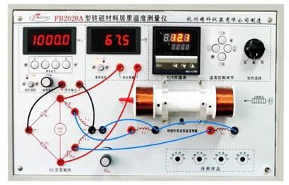

- **平衡电桥调节**
- 0. 按电路图连接仪器。
- 1. 接通电源，“频率调节”为1000Hz，

“波形选择”为“正弦波”，

“量程选择”开始选2000mV，适时更换为200mV，

“幅度调节”基本调至最大。

- 2. 调节Rw，使交流电压表示值最小（理想情况1.0mV以下，最低要求3.0mV以下），此时电桥平衡。此时若将样品插入电感L2中，电压表示数需要在100mV以上。
- 3. 尝试将“频率调节”为500Hz，其它设置不变，调节电桥平衡。

与1000Hz时进行比较，有何区别？想想为什么？

1

实验背景

EXPERIMENT BACKGROUNDS

1

实验背景

EXPERIMENT BACKGROUNDS

## **物质磁性分类**

### **按磁性能：**

铝镍钴

铁氧体

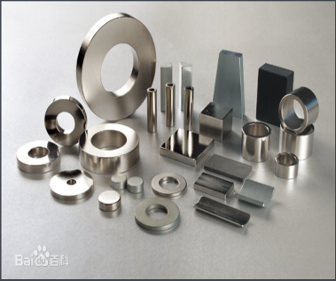

稀土永磁

（ 钕铁硼）

### **强磁性**

### **弱磁性**

### **按用途：**

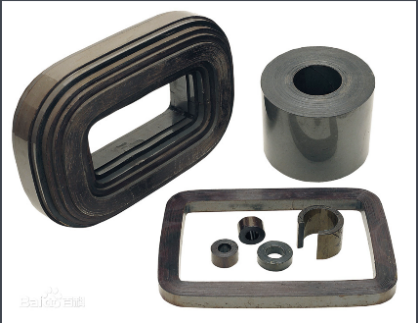

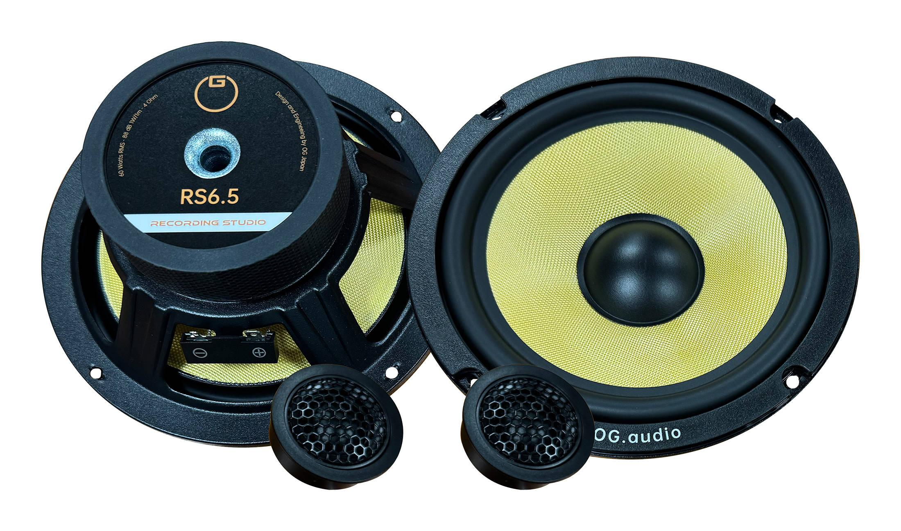

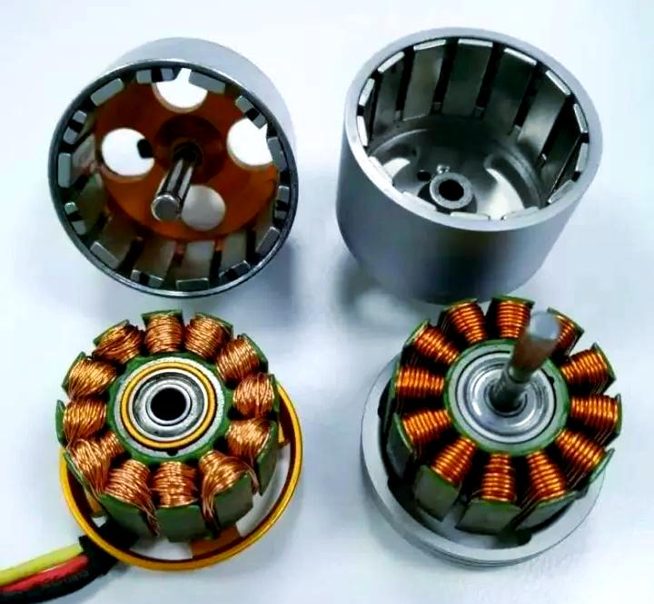

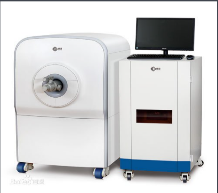

**5**

1

实验背景

EXPERIMENT BACKGROUNDS

## **磁性材料的居里温度**

- 居里温度： 磁性材料的磁性参数之一。

最早由法国物理学家皮埃尔·居里（Pierre Curie）在 19 世纪末提出。

升温

- 本实验根据铁磁物质磁矩随温度变化的特性，采用***交流电桥法***测量居里温度。

**6**

2

EXPERIMENT OBJECTIVE

实验目的

2

实验目的

EXPERIMENT OBJECTIVE

1. 了解铁磁物质由铁磁性转变为顺磁性的微观机理。

2．利用交流电桥法测定铁磁材料样品居里温度。

3．分析加热速率和交流电桥输入信号频率对居里温度测试结果的影响。

3

EXPERIMENT  PRINCIPLE

实验原理

3

实验原理

EXPERIMENT PRINCIPLE

## **3.1 原子类型决定材料磁化行为**

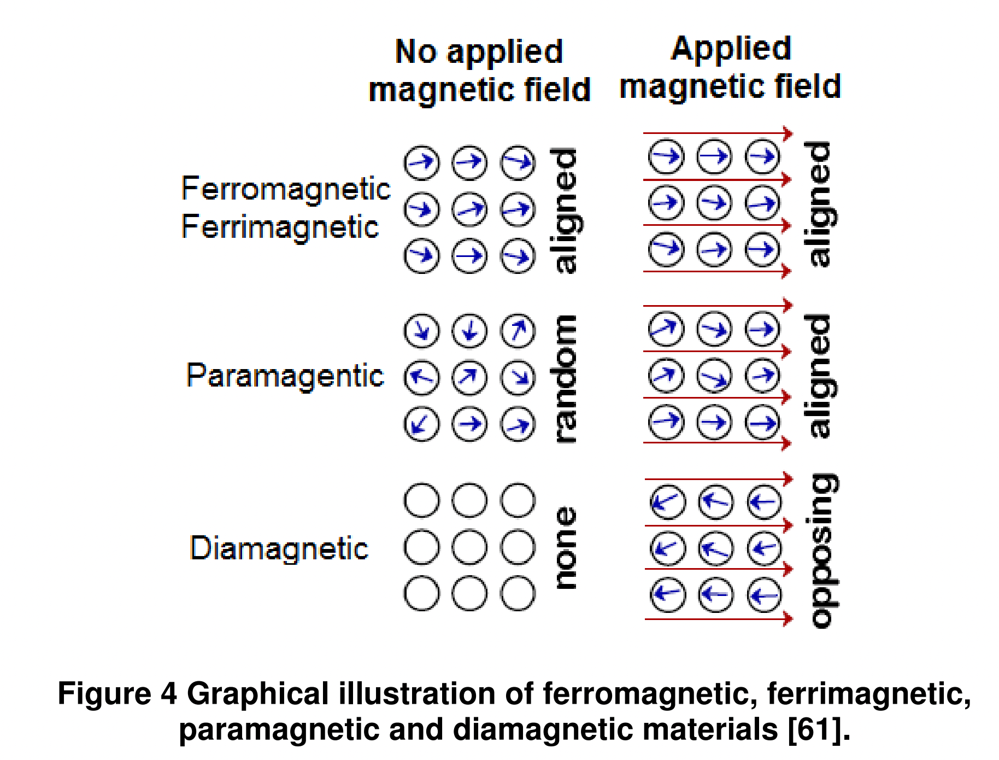

- **铁磁**

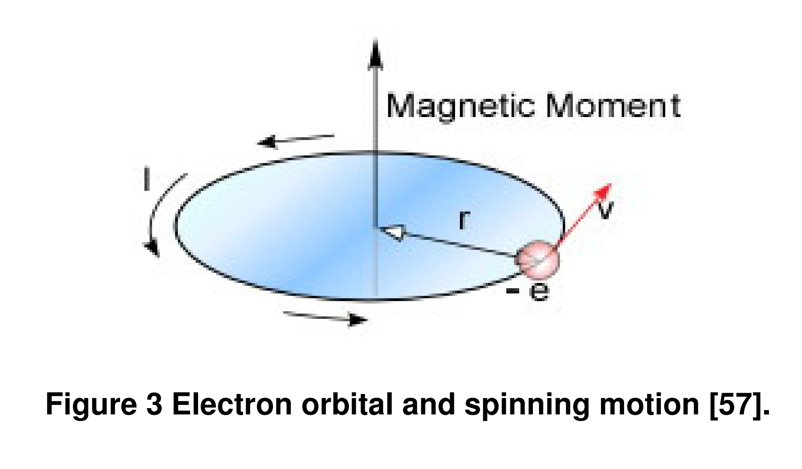

- **亚铁磁**

- **顺磁**

- **抗磁**

- **原子磁矩**

### **（由电子的自旋和轨道运动产生）**

3

实验原理

EXPERIMENT PRINCIPLE

## **3.2 铁磁质的磁化规律**

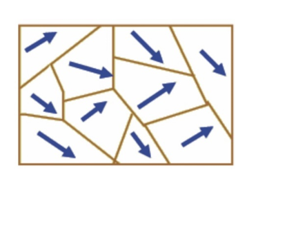

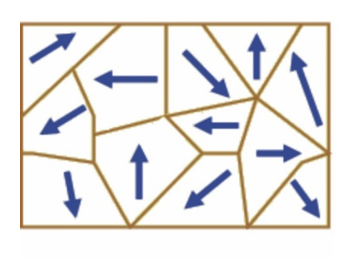

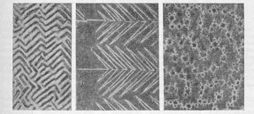

左图： 未加磁场多晶磁畴结构                      中图：加磁场多晶磁畴结构                                                           右图：磁畴照片

- **铁磁质具有磁畴：**

### **无外加磁场时，原子磁矩之间存在交换作用（量子力学效应：相邻原子的自旋倾向于平行排列，以最小化系统的总能量）而自发对齐。** **这种作用使得大量磁矩在局部区域（磁畴）中排列一致（强烈的自发磁化）；但整体材料的外部磁场可以很弱（磁化方向不同的磁畴的形成，达到能量最小化状态）。**

3

实验原理

EXPERIMENT PRINCIPLE

## **3.3 基本磁学量**

- 对于处于外磁场中的磁体，磁介质的磁化规律可用磁感应强度B、磁化强度M和磁场强度H来描述：

其中，参数**0 = 4π×10-7H/m为真空磁导率， *μ*为绝对磁导率， *μ*r为相对磁导率，是表征磁体磁化难易程度的一个磁学量， *χ*m为磁化率，表征磁体磁性强弱。

- 非铁磁性各向同性磁介质：   B=μH (线性关系：μr接近于1，且在一定范围内是常数)
- 铁磁性介质： B，μ，H关系非线性

顺磁性：*χ*m>0, *μ*r略大于1

抗磁性：*χ*m<0, *μ*r略小于1

铁磁性：*χ*m>>1, *μ*r>>1

3

实验原理

EXPERIMENT PRINCIPLE

## **3.4 铁磁质的B-H关系**

- 磁场强度H

H 较小时，相对磁导率μr很高，磁畴在外加磁场作用下容易对齐；

随着 H 增加，磁化趋于饱和，相对磁导率开始降低并最终趋于常数。

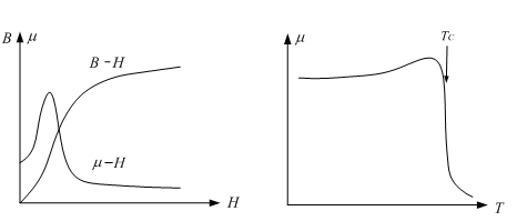

- 磁滞效应

B-H 曲线呈现滞回特性：材料的磁化状态不仅取决于当前的外加磁场，还与磁化历史有关。

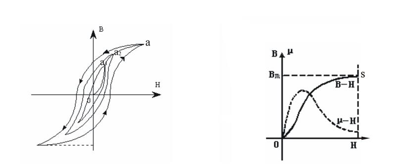

3

实验原理

EXPERIMENT PRINCIPLE

## **3.5 铁磁质的B-H关系**

- 温度
- 相对磁导率强烈依赖于温度；
- 当温度接近材料的居里温度时，材料从铁磁态转为顺磁态，导致相对磁导率显著下降至接近 1。

- **材料的微观结构**

**晶粒尺寸、晶体取向、晶界、位错和杂质含量……**

Tc:居里温度

- 居里温度微观机理：

交换作用（促使相邻磁矩平行排列的力）与 随机热振动（磁矩随机分布）之间的竞争

3

实验原理

EXPERIMENT PRINCIPLE

## **3.6 用交流电桥测量居里温度**

- 交流电桥的基本电路:

### **四臂阻抗电路**

- 电桥达到平衡时，复数等式                的模量和辐角分别相等。

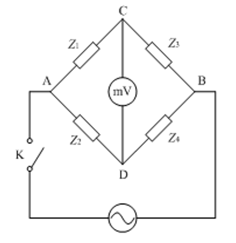  
图： 交流电桥的基本电路

3

实验原理

EXPERIMENT PRINCIPLE

## **3.6 用交流电桥测量居里温度**

$R_{a}$

$R_{b}$

$R_{1}$

$L_{1}$

$R_{w}$

$L_{2}$

$U_{0}$

- 电桥平衡时：

$R_{a}\left(R_{w}+j\omega L_{2}\right)=R_{b}\left(R_{1}+j\omega L_{1}\right)$

- 电感 $L_{2}$ 中插入铁氧体样品后，电桥不平衡：

$U_{CD}=U_{0}$ ( $\frac{R_{a}}{R_{a}+R_{1}+j\omega L_{1}}-$  $\frac{R_{b}}{R_{b}+R_{w}+j\omega L_{2}}$ )

$L=\frac{\mu N^{2}A}{l}\propto \mu$ (T)

$N:线圈匝数$

$A:截面积$

$l:线圈长度$

- 电感 $L_{2}$ 变化 $\Delta L_{2}$

$\Delta U_{CD}\propto \frac{\partial U_{CD}}{\partial L_{2}}$  $\Delta L_{2}\propto \omega \frac{\Delta L_{2}}{（R_{b}+R_{w}+j\omega L_{2}）^{2}}$

- $U_{CD}$ 表达 $\mu 随温度的变化$

$U_{CD}$

Tc:居里温度

Tc:居里温度

$\mu$

$R_{a}=R_{b}=100\Omega$

4

EXPERIMENTAL DEVICE

实验装置

4

实验装置

EXPERIMENTAL DEVICE

励磁交流信号频率调节

励磁交流信号幅度调节

电压表

温度表

交流电桥

居里温度测量仪、导线、待测样品

电感、

样品加热槽

待测样品

5

EXPERIMENT CONTENT

实验内容

5

实验内容

EXPERIMENT CONTENT

## **5.1 实验内容**

- **平衡电桥调节(预备实验）**
- 1. 接通电源，“频率调节”为1000Hz，“波形选择”为“正弦波”，“量程选择”开始选择2000mV，适时更换为200mV，“幅度调节”基本调至最大。
- 2. 调节Rw，使交流电压表示值最小（理想情况1.0mV以下，最低要求3.0mV以下），此时电桥平衡。
- **升温曲线测量**
- 1. 将待测样品均匀涂上导热硅脂后，插入右侧空心线圈中的加热铜管内，此时电桥不平衡，记录交流电压表示数；
- 2. “加热选择”置于“低”档，记录从室温加热至参考居里温度值 $+30\text{°C}$ 过程中电压表的读数与对应的温度，其中在参考温度值 $\pm 15\text{°C}$ 范围内每0.5 $\text{°C}记一次数据$ 。
- **降温曲线测量**
- 将“加热选择”置于“断”档，记录降至参考居里温度值温 $-30\text{°C}$ 过程中电压表读数和温度。

5

实验内容

EXPERIMENT CONTENT

## **5.2 注意事项**

- 样品加热后，不要用手触碰加热线圈和样品，以免烫伤。
- **实验过程中，保持信号发生器的幅度和样品在电感线圈中的位置不变。**
- **注意电压表量程选择，开始实验时选择2000mV，当电压值下降至200mV以下，应切换量程至200mV，以获得更高的电压测量精度。请注意，调节电桥平衡时，尽量调到1.0mV以下，需要耐心地左右微调。（如果难以调至1.0mV，调至3.0mV以下也可开始实验，请思考会对结果会造成怎样的影响？）**
- **在居里温度标称值的正负** $15\text{°C}$  **，电压值会快速变化，应合理调整温度间隔，比如** $1\text{°C}$ **，** $\mathbf{0}.\mathbf{5}\text{°C}$  **，在这个区间可以用手机拍摄视频。**

5

实验内容

EXPERIMENT CONTENT

## **5.3 居里温度的不同定义方式**

- 实际材料经常存在缺陷或微观组织不均匀，材料各部分的相变点并非在同一温度点，而是分布在小温度区间内。
- 实验测量中可以选择不同的方式定义居里温度：

### **区间上/下限法**

### **拐点法**

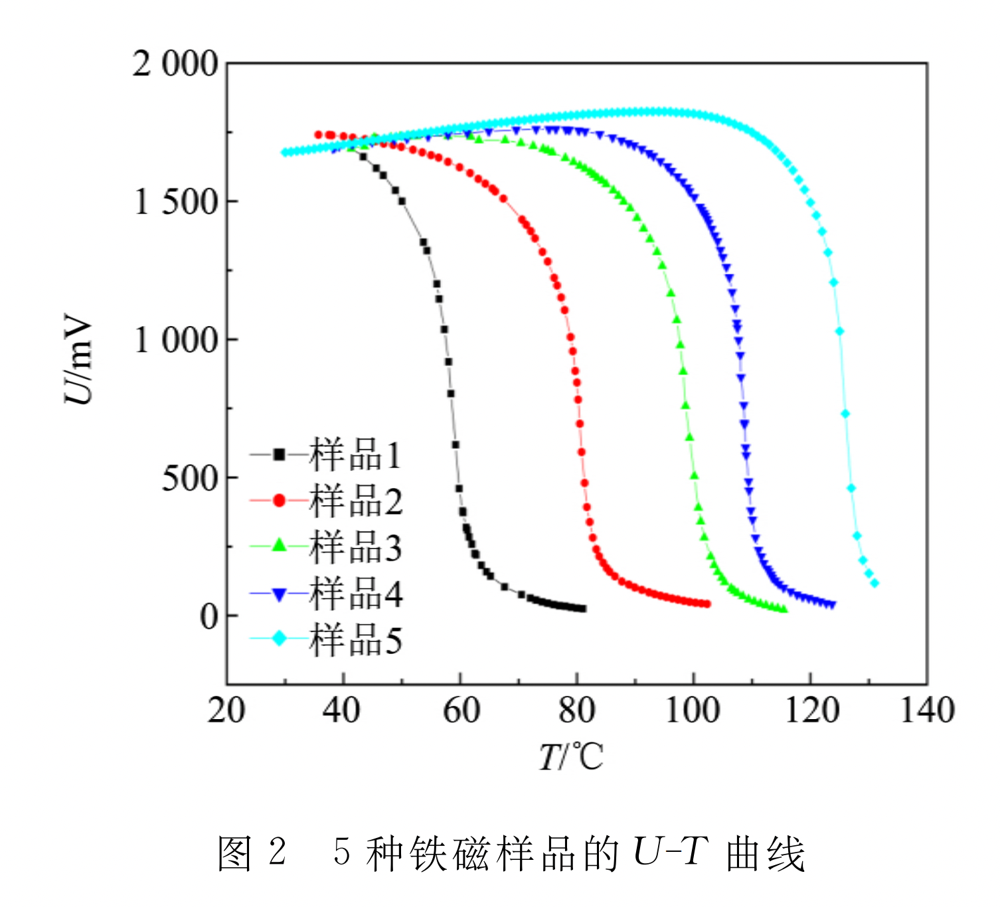

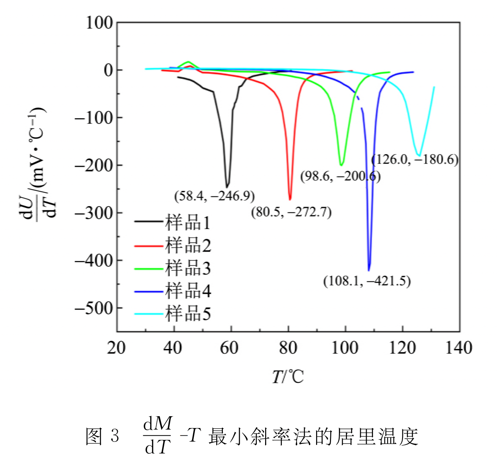

斜率最大，推荐方法

快速判断，存在偏差

### **切线外推法**

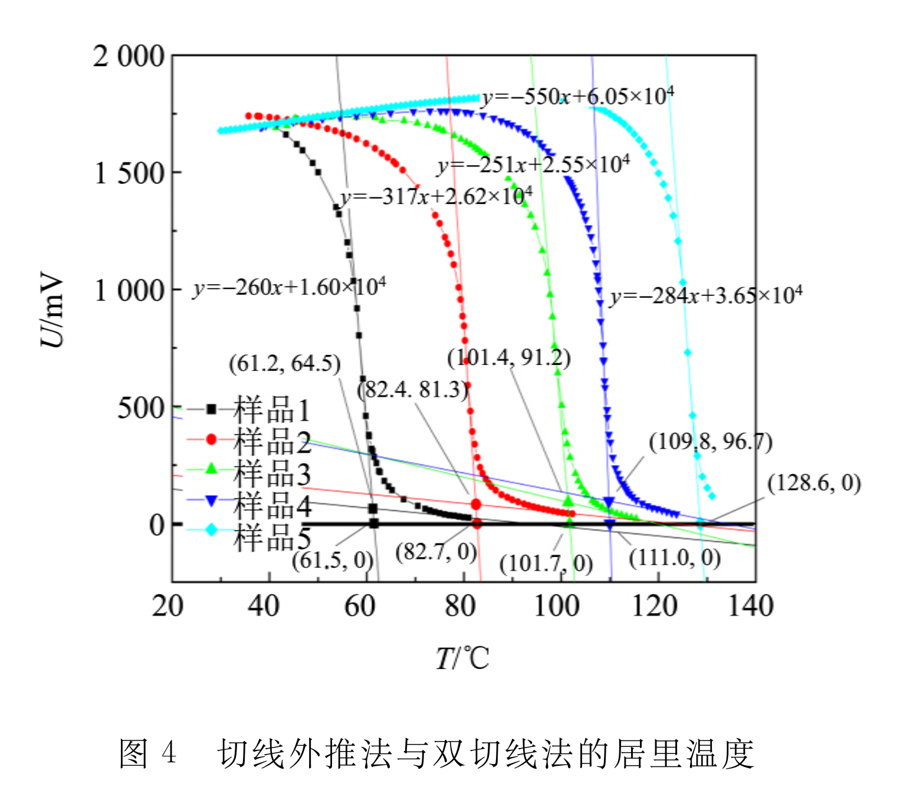

高精度测量

Ref:王昊,何春娟.铁磁材料居里温度测量的近似分析及居里转换的意义[J].物理实验,2021,41(10):55-58.

5

实验内容

EXPERIMENT CONTENT

## **5.4 数据处理要求：**

1. 利用表格记录数据，用绘图软件绘制**升温和降温的U-T曲线图（在同一图表中）**，分析比较升温和降温曲线的不同之处。注意作图规范。
2. 利用测量数据求得**居里温度（如拐点法）**。
3. 按照绪论课上讲的误差种类分析本实验的误差。

6

实验拓展

EXPERIMENTAL EXTENSION

6

实验拓展

EXPERIMENTAL EXTENSTION

## **思考题：**

- 1. 升温和降温曲线是否有区别？如有区别，原因是什么？
- 2. 测出的U～T曲线，为什么与横坐标没有交点？
- 3. 除了交流电桥法，还有哪些测量居里温度的方法？

6

实验拓展

EXPERIMENTAL EXTENSTION

## **思考题：**

- 1. 升温和降温曲线是否有区别？如有区别，原因是什么？

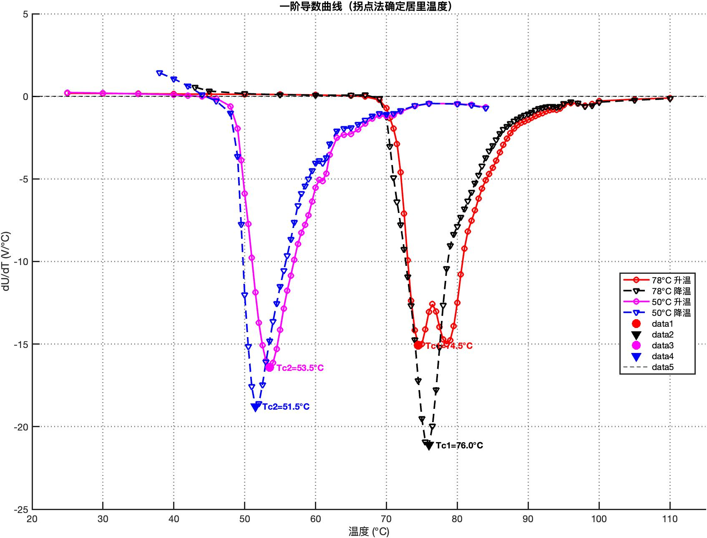

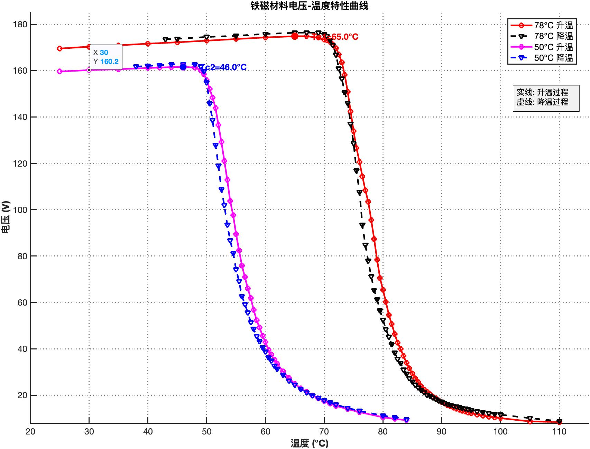

- 对本实验装置，利用降温曲线测居里温度更加准确。

6

实验拓展

EXPERIMENTAL EXTENSTION

## **拓展实验**

- 1. 交流电频率对实验的影响
- 2. 加热速率对实验的影响
- 3. 电桥调平对实验的影响

实验拓展

6

EXPERIMENTAL EXTENSTION

<table>
  <tr>
    <th>78$℃$样品
低档加热</th>
    <th>升温</th>
    <th>降温</th>
  </tr>
  <tr>
    <td>500Hz</td>
    <td>74.0</td>
    <td>75.5</td>
  </tr>
  <tr>
    <td>1000Hz</td>
    <td>74.5</td>
    <td>76.0</td>
  </tr>
</table>

## **拓展实验**

- 1. 交流电频率对实验的影响

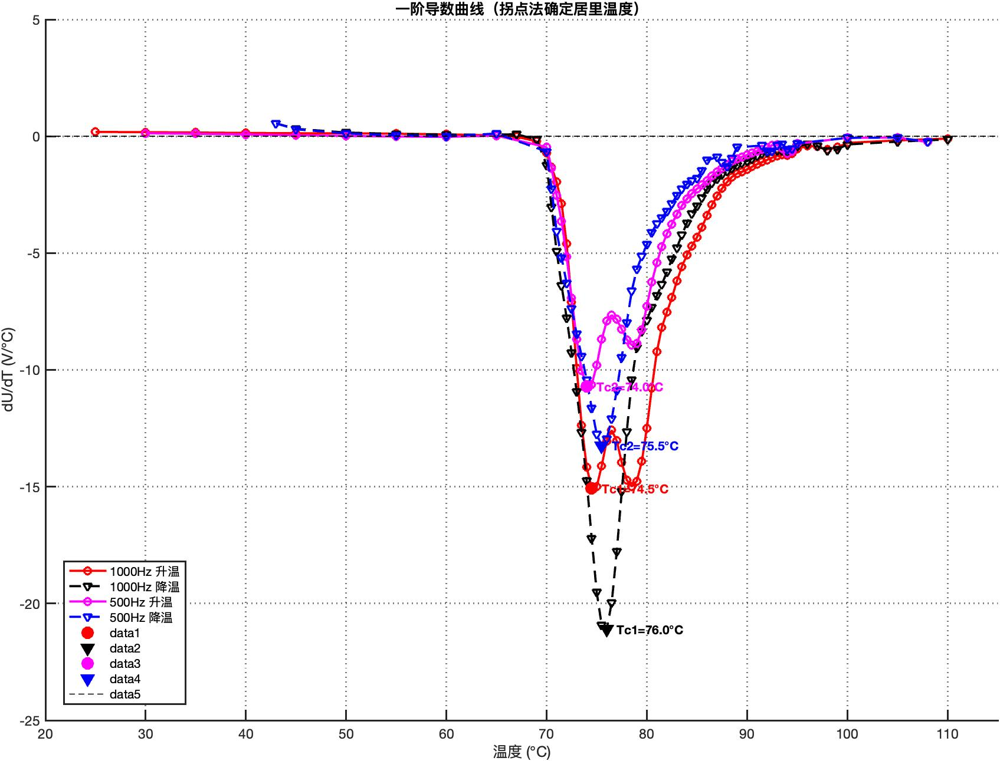

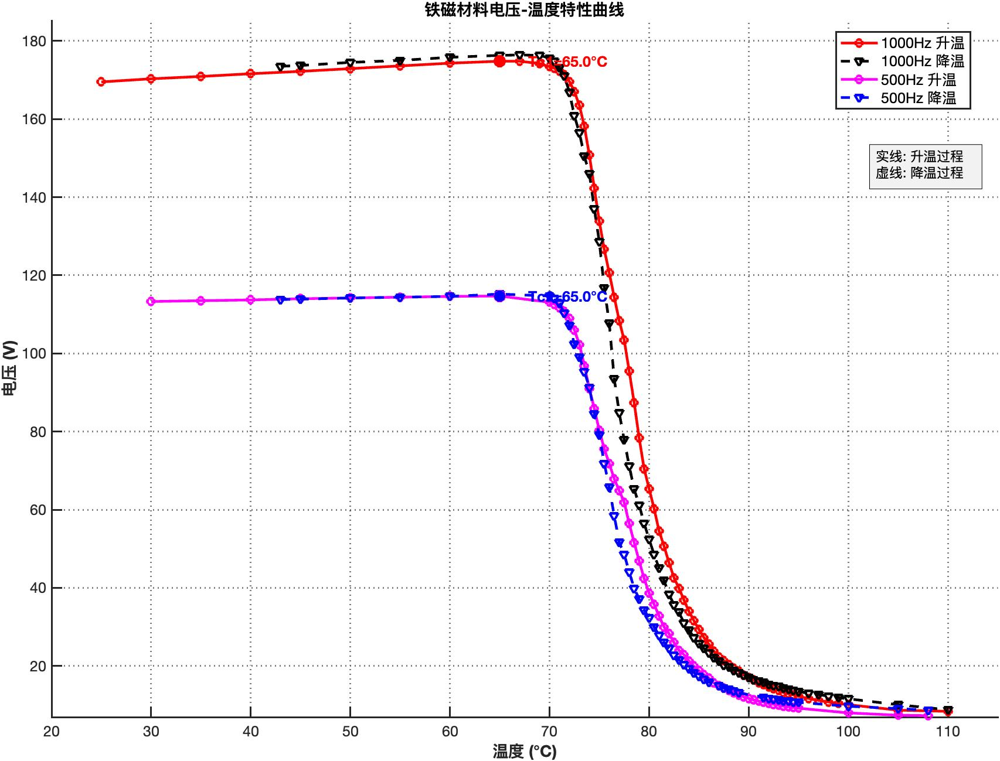

- 高频交流电条件下测量更准确。

Ref: 高喜梅,胡健,黄耀清.工作频率对测量磁性材料居里温度的影响[J].上海应用技术学院学报(自然科学版),2011,11(02):164-166.

6

实验拓展

EXPERIMENTAL EXTENSTION

<table>
  <tr>
    <th>78$℃$样品
1000Hz</th>
    <th>升温</th>
    <th>降温</th>
  </tr>
  <tr>
    <td>高档加热</td>
    <td>79.0</td>
    <td>75.5</td>
  </tr>
  <tr>
    <td>低档加热</td>
    <td>74.5</td>
    <td>76.0</td>
  </tr>
</table>

## **拓展实验**

- 2. 加热速率对实验的影响

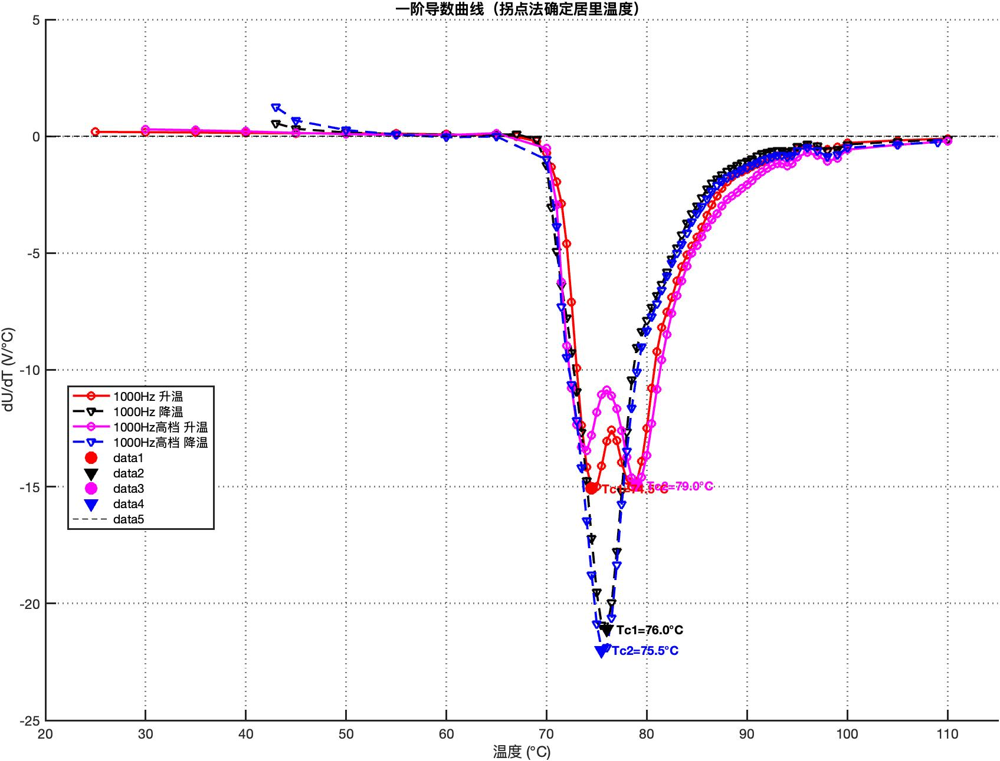

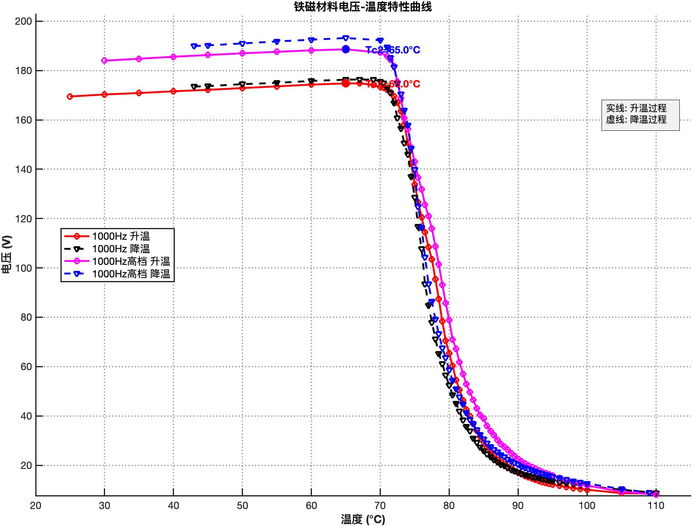

- 加热速率快，测得居里温度偏高。低档加热测量更准确。

Ref:吴梓坚,谢昊,王子生,等.磁性材料居里温度测量结果影响因素分析[J].稀有金属,2025,49(01):146-152.

6

实验拓展

EXPERIMENTAL EXTENSTION

<table>
  <tr>
    <th>78$℃$样品
1000Hz</th>
    <th>升温</th>
    <th>降温</th>
  </tr>
  <tr>
    <td>调平电压$U_0=10.0mV$</td>
    <td>77.5</td>
    <td>75.5</td>
  </tr>
  <tr>
    <td>调平电压$U_0=1.3mV$</td>
    <td>74.5</td>
    <td>76.0</td>
  </tr>
</table>

## **拓展实验**

- 3. 电桥调平对实验的影响

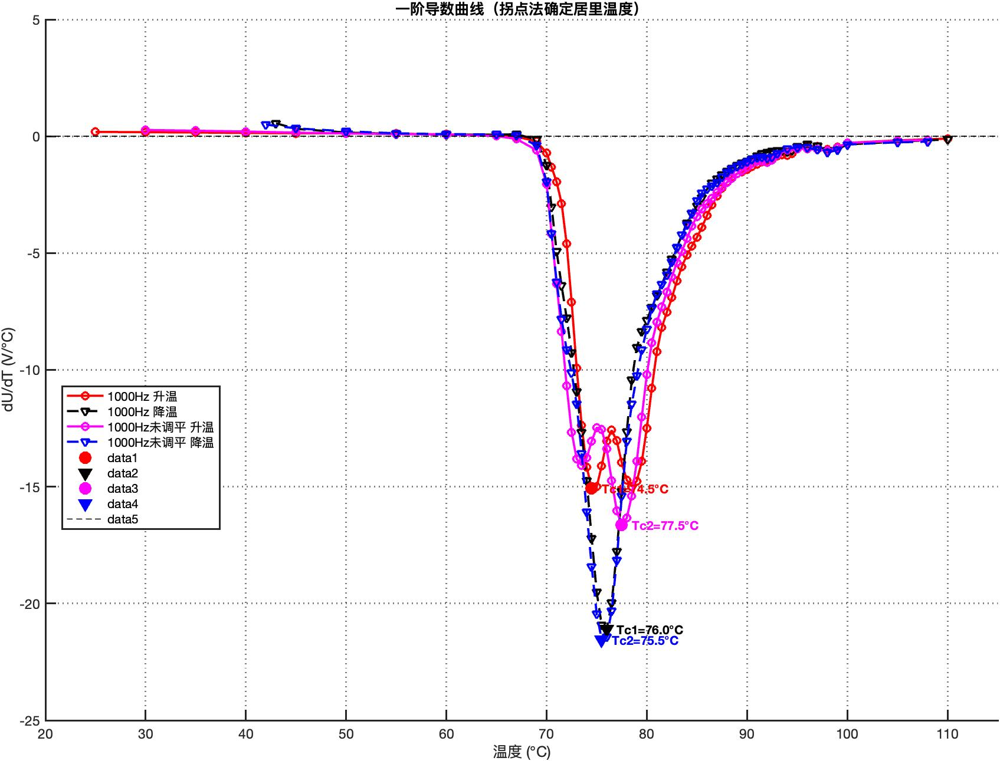

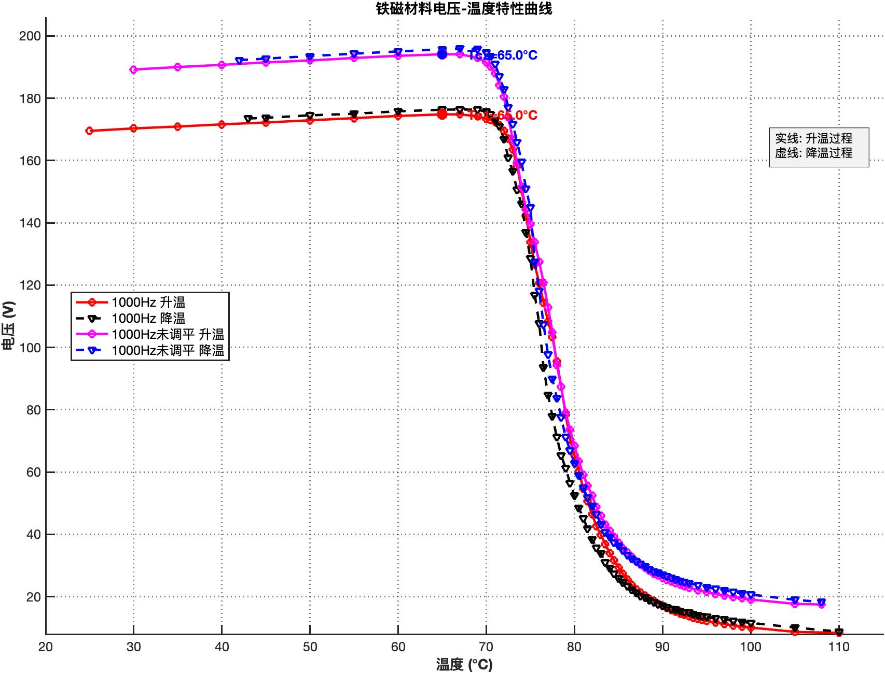

- 引入系统误差，少量偏置对降温曲线上测量居里温度影响不大。

谢谢

**铁磁材料居里温度测量**

THANKS FOR LISTENING

7

附录

Appendix

<table>
  <tr>
    <th>50$℃$样品
低档加热</th>
    <th>升温</th>
    <th>降温</th>
  </tr>
  <tr>
    <td>500Hz</td>
    <td>53.0</td>
    <td>51.5</td>
  </tr>
  <tr>
    <td>1000Hz</td>
    <td>53.5</td>
    <td>51.5</td>
  </tr>
</table>

- 交流电频率对实验的影响

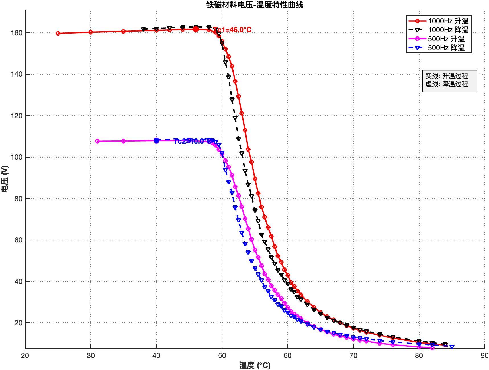

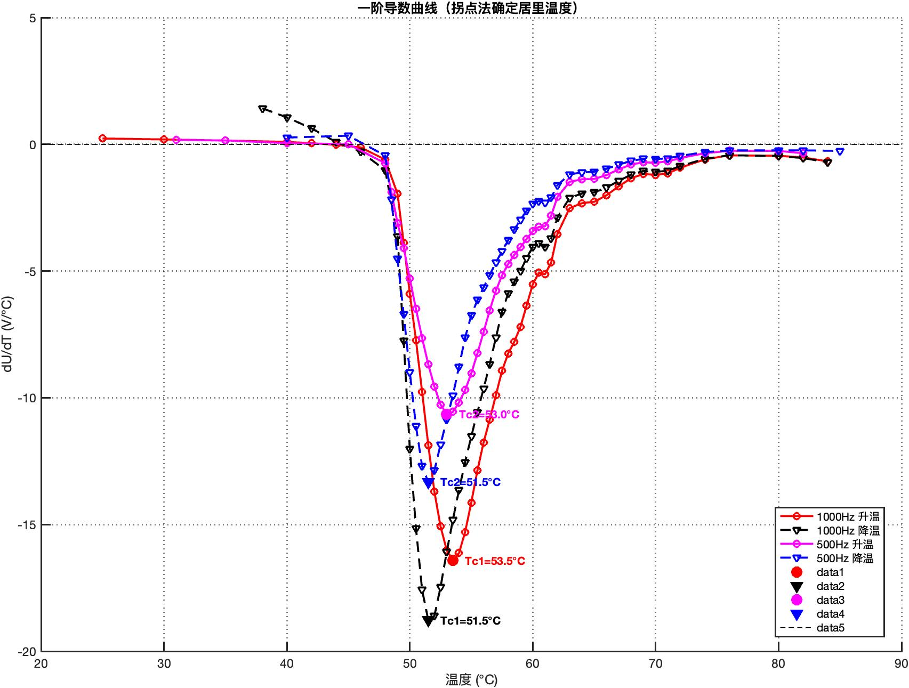