铁磁材料磁化曲线和磁滞回线的研究

（FB310D型磁特性综合测量实验仪）

实验讲义

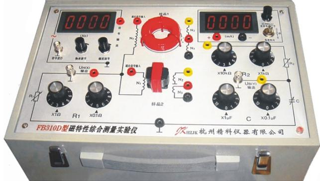

杭州精科仪器有限公司

## 一、磁化曲线与磁滞回线的研究

铁磁材料分为硬磁和软磁两类。硬磁材料（如铸钢）的磁滞回线宽，剩磁和矫顽磁力较大（100-20000 安/米，甚至更高），因而磁化后，它的磁感应强度能保持，适宜制作永久磁铁。软磁材料（如硅片）的磁滞回线窄，矫顽磁力小（一般小于120安/米），但它的磁导率和饱和磁感应强度大，容易磁化和去磁，故常用于制造电机、变压器和电磁铁。可见，铁磁材料的磁化曲线与磁滞回线是该材料的重要特性，也是设计电磁机构或仪表的依据之

磁学量的测量一般比较困难，通常利用相应的物理规律，将磁学量转换为易于测量的电学量。这种转换测量法是物理实验中常用的基本方法。测绘磁化曲线与磁滞回线常用冲击电流计法和示波器法，是磁测量的基本方法。前者方法准确度较高，但较复杂，后者方法虽然准确度较低但具有直观、方便迅速以及能在脉冲磁化下测量的优点。本实验采用示波器法，通过实验，研究这些性质不代仅能掌握用示波器观察磁滞回线以及基本磁化曲线的测绘方法，从而能从理论和实际应用上加深材料磁特性的认识。

本实验采用动态法测量磁滞回线。需要说明的是用动态法测量的磁滞回线与静态磁滞回线是不同的，动态测量时除了磁滞损耗还有涡流损耗，因此动态磁滞回线的面积要比静态磁滞回线的面积要大一些。另外涡流损耗还与交变磁场的频率有关，所以测量的电源频率不同，得到的 曲线是不同的，这可以在实验中清楚地从示波器上观察到。B - H

## 【实验目的】

1．掌握磁滞、磁滞回线和磁化曲线的概念，加深对铁磁材料的主要物理量：矫顽力、剩磁和磁导率的理解。

2．学会用示波器法测绘基本磁化曲线和磁滞回线。

3．根据磁滞回线确定磁性材料的饱和磁感应强度 $B _ { s }$ 、剩磁 和矫顽力Br $H _ { c }$ 的数值。

4．研究不同频率下动态磁滞回线的区别，并确定某一频率下的磁感应强度 $B _ { s }$ 、剩磁Br和矫顽力 $H _ { c }$ 数值。

5．改变不同的磁性材料，比较磁滞回线形状的变化。

## 【实验仪器】

双踪示波器、FB310D型磁特性综合测量实验仪。

## 【实验原理】

## 1.起始磁化曲线、基本磁化曲线和磁滞回线

铁磁材料（如铁、镍、钴和其它铁磁合金）具有独特的磁化性质。研究铁磁材料的磁化规律，一般是通过测量磁化场的磁场强度H与磁感应强度B之间的关系来进行的。铁磁

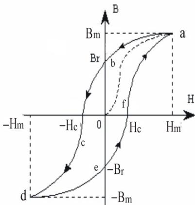  
图 1

材料的磁化过程非常复杂，B 与 H之间的关系如图 1 所示。当铁磁材料从未磁化状态（H=0且B=0）开始磁化时，B随着H的增加而非线性增加。当H增大到一定值 $H _ { \mathrm { m } }$ 后，$B _ { \mathrm { m } }$ 增加十分缓慢或基本不再增加，这时磁化达到饱和状态，称为磁饱和。达到磁饱和时的$H _ { \mathrm { m } }$ 和 $B _ { \mathrm { m } }$ 分别称为饱和磁场强度和饱和磁感应强度（对应图中的 a 点）。图 1 中，B～H曲线的Oa段称为起始磁化曲线。当使H从a点减小时，B也随之减小，但不沿原曲线返回，而是沿另一曲线 $a b$ 下降。当H逐步较小至0时，B不为0，而是 $B _ { r }$ ，说明铁磁材料中仍保留有一定的磁性，这种现象称为磁滞效应； $B _ { r }$ 称为剩余磁感应强度，简称剩磁。要消除剩磁，使B降为0，必须加一反向的磁场，直到反向磁场强度 $H { = } { - } H _ { c }$ ，B才恢复为0， $H _ { c }$ 称为矫顽力。继续反向增加H，曲线达到反向饱和（d点），对应的饱和磁场强度为 $- H _ { m }$ ，饱和磁感应强度为- $\cdot B _ { m }$ 。再正向增加H，曲线回到起点 $a \textdegree$ 。从铁磁材料磁化过程可知，当H按 O→$H _ { m } {  } 0 {  } - H _ { c } {  } - H _ { m } {  } 0 {  } H _ { c } {  } H _ { m }$ 的顺序变化时，B 相应沿 $\mathrm { O } {  } B _ { m } {  } B _ { r } {  } \mathrm { O } {  } { - } B _ { m } {  } { - } B _ { r } {  } \mathrm { O } {  }$ $B _ { m }$ 的顺序变化。将上述变化过程的各点连接起来，就得到一条封闭B～H曲线abcdefa，这条闭合曲线称为磁滞回线。采用直流励磁电流产生磁化场对材料样品反复磁化测出的磁滞回线称为静态（直流）磁滞回线，采用交变流励磁电流产生磁化场对材料样品反复磁化测出的磁滞回线称为动态（交流）磁滞回线。

从图1中还可知：

（1）B的变化始终落后于H的变化，这种现象称为磁滞现象。

（2）图中的bc曲线段，称为退磁曲线。

（3）H 上升到某一值和下降到同一数值时，铁磁材料内的 B 值不相同，即磁化过程与铁磁材料过去的磁化经历有关。

对于同一铁磁材料，若开始时不带磁性，依次选取磁化电流为 $I _ { I \setminus } \ I _ { 2 \setminus } \ \cdots \ , \ I _ { m } \ ( I _ { I } { < } I _ { 2 }$ $< \cdots < I _ { m } )$ ），则相应的磁场强度为 $H _ { I } , \ H _ { 2 } , \ \cdots , \ H _ { m }$ 。在每一个选定的磁场值下，使其方向发生二次变化（即 $H _ { I } {  } { - } H _ { I } {  } H _ { I } ; ~ { \cdots } ; ~ H _ { m } {  } { - } H _ { m } {  } H _ { m } { \xrightarrow { \kappa { \nleftarrow } } } )$ ），则可以得到面积由小到大向外扩张的一族逐渐增大的磁滞回线（如图2所示）。把原点O和各个磁滞回线的顶点 $a _ { I } , ~ a _ { 2 } , ~ \cdots$ 、

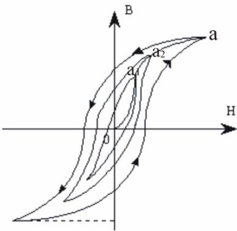  
图 2

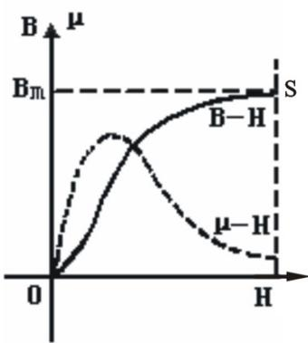  
图 3

$a _ { m }$ 所连成的曲线，称为铁磁材料的基本磁化曲线。根据基本磁化曲线可以近似确定铁磁材料的磁导率 $\mu _ { \circ }$ 。从基本磁化曲线上一点到原点 O 连线的斜率定义为该磁化状态下的磁导率 $\mu = { \frac { B } { H } }$ 。可以看出，铁磁材料的磁导率不是常数，而是随H变化而变化的物理量，即 $\mu = f \bigl ( H \bigr )$ ，为非线性函数。当H由0增加时，μ也逐步增加，然后达到一最大值。当H再增加时，由于磁感应强度达到饱和， $\mu$ 开始急剧减小。μ随H变化曲线如图3所示。磁导率 $\mu$ 非常高是铁磁材料的主要特性，也是铁磁材料用途广泛的主要原因之一。

由于铁磁材料磁化过程的不可逆性及具有剩磁的特点，在测定磁化曲线和磁滞回线时，首先必须将铁磁材料退磁，以保 证外加磁场H=0时，B=0；其次，磁化电流在实验过程中只允许单调增加或减少，不可时增时减。

在理论上，要消除剩磁 $B _ { r }$ ，只需通一反方向磁化电流，使外加磁场正好等于铁磁材料的矫顽磁力就行。实际上，矫顽磁力的大小通常并不知道，因此无法确定退磁电流的大小。我们从磁滞回线得到启示：如果使铁磁材料磁化达到饱和，然后不断改变磁化电流的方向，与此同时逐渐减小磁化电流，以至于零，那末该材料磁化过程就是一连串逐渐缩小最终趋于原点的环状曲线。当H减小到零时，B也降为零，达到完全退磁。

实验表明，经过多次反复磁化后， 的量值关系形成一个稳定的闭合的“磁滞回B - H线”。通常以这条曲线来表示该材料的磁化性质。这种反复磁化的过程称为“磁锻炼”。本实验使用交变电流，所以每个状态都是经过充分的“磁锻炼”，随时可以获得磁滞回线。

在测量基本磁化曲线时，每个磁化状态都要经过充分的“磁锻炼”。否则，得到的B-H曲线即为起始磁化曲线，两者不可混淆。

## 2、磁滞损耗

当铁磁材料沿着磁滞回线经历磁化→去磁→反向磁化→反向磁化的循环过程中，由于磁滞效应，要消耗额外的能量，并且以热量的形式消耗掉。这部分因磁滞效应而消耗的能量，叫磁滞损耗 $( B _ { H } )$ ）。一个循环过程中单位体积磁性材料的磁滞损耗正比于磁滞回线所围的面积。在交流电路中，磁滞损耗是十分有害的，必须尽量减小。要减小磁滞损耗，就应选择磁滞回线狭长、包围面积小的铁磁材料。如图4所示，工程上把磁滞回线细而窄、矫顽力很小 $( H _ { C \sim } { \sim } 1$ 安培/米 $( 1 0 ^ { - 2 }$ 奥斯特）〕的铁磁材料称为软磁材料；把磁滞回线宽、矫顽力大 $( H _ { C } { \sim } 1 0 ^ { 4 } { \sim } 1 0 ^ { 6 }$ 安培/米 $( 1 0 ^ { 2 } { \sim } 1 0 ^ { 4 }$ 奥斯特）〕的铁磁材料称为硬磁材料。软磁材料适合做继电器、变压器、镇流器、电动机和发电机的铁芯。硬磁材料则适合于制造许多电器设备（如电表、电话机、扬声器、录音机）的永久磁体。

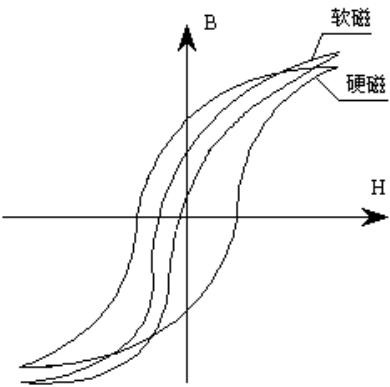  
图 4

## 3．示波器显示 曲线的原理线路：B - H

示波器测量 曲线的实验线路如图5所示。B - H

本实验研究的铁磁物质是环形铁芯（铁氧体）试样如图6所示和EI型矽钢片铁芯试样如图 7 所示。两种试样均为软磁，图中的虚线表示该试样的平均磁路长度。在试样上绕有励磁线圈 $N _ { \scriptscriptstyle 1 }$ 、测量线圈 $N _ { 2 }$ 和直流励磁线圈 $N _ { 3 }$ （供加入直流电流用）。

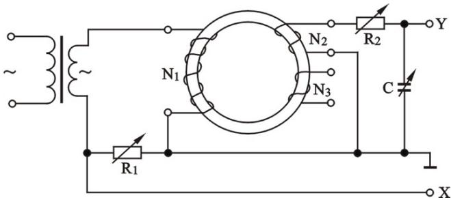  
图 5

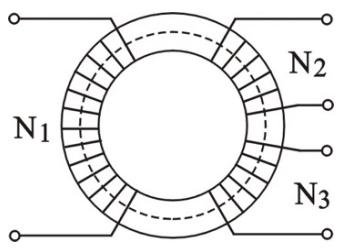  
图 6

若在线圈 $N _ { 1 }$ 中通过磁化电流 $I _ { \mathrm { \Omega _ { 1 } } }$ 时，此电流在试样内产生磁场，根据安培环路定律 ${ \cal H } \bullet { \cal L } = { \cal N } _ { 1 } \bullet { \cal I } _ { 1 }$ ，磁场强度的大小为：

$$
H = \frac {N _ {1} \bullet I _ {1}}{L}\tag{1}
$$

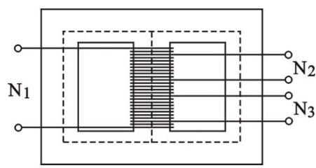  
图 7

其中 为的环形铁芯试样的平均磁路长度。设环形铁芯内周长为L $\mathrm { L } _ { 1 }$ ，外周长为 $\mathrm { L } _ { 2 }$ ，

则： $L = { \frac { \left( L _ { 1 } + L _ { 2 } \right) } { 2 } }$

由图5可知示波器 (X)轴偏转板输入电压为：CH1 $U _ { X } = I _ { 1 } \bullet R _ { 1 }$

（2）

由式（1）和式（2）得：

$$
U _ {X} = \frac {L \bullet R _ {2}}{N _ {1}} \bullet H\tag{3}
$$

上式表明在交变磁场下，任一时刻电子束在 轴的偏转正比于磁场强度 。X H

为了测量磁感应强度 B，在次级线圈 $N _ { 2 }$ 上串联一个电阻 $R _ { 2 }$ 与电容 构成一个回路，C同时 $R _ { 2 }$ 与 $C$ 又构成一个积分电路。取电容 两端电压C $U _ { c }$ 至示波器 ( )轴输入，若适CH2 Y当选择 $R _ { 2 }$ 和 使C $R _ { 2 } > > { \frac { 1 } { \omega \bullet C } }$ ，则： $I _ { 2 } = \frac { E _ { 2 } } { \left[ R _ { 2 } ^ { 2 } + \left( \displaystyle \frac { 1 } { \omega \bullet C } \right) ^ { 2 } \right] ^ { \frac { 1 } { 2 } } } \approx \frac { E _ { 2 } } { R _ { 2 } }$

式中， 为电源的角频率，w $E _ { 2 }$ 为次级线圈的感应电动势。

因交变的磁场 的样品中产生交变的磁感应强度 ，则：H B

$$
E _ {2} = N _ {2} \bullet \frac {d \phi}{d t} = N _ {2} \bullet S \bullet \frac {d B}{d t} \quad \text {式中} S = \frac {(D _ {2} - D _ {1})}{2} \bullet h \text {为环形试样的截面积,}
$$

设磁环厚度为 则：h

$$
U _ {Y} = U _ {C} = \frac {Q}{C} = \frac {1}{C} \int I _ {2} d t = \frac {1}{C \bullet R _ {2}} \int E _ {2} d t = \frac {N _ {2} \bullet S}{C \bullet R _ {2}} \int d B = \frac {N _ {2} \bullet S}{C \bullet R _ {2}} \bullet B\tag{4}
$$

上式表明接在示波器 轴输入的Y $U _ { Y }$ 正比于 。B $R _ { 2 } \bullet C$ 电路在电子技术中称为积分电路，表示输出的电压 $U _ { c }$ 是感应电动势 $\mathrm { E } _ { 2 }$ 对时间的积分。为了如实地绘出磁滞回线，要求： AB

$$
R _ {2} > > \frac {1}{2 \pi \bullet f \bullet C} 。\tag{1}
$$

（2）在满足上述条件下， $U _ { c }$ 振幅很小，不能直接绘出大小适合需要的磁滞回线。为此，需将 $U _ { c }$ 经过示波器 轴放Y大器增幅后输至 轴偏转板上。这就要求在实验磁场的频Y率范围内，放大器的放大系数必须稳定，不会带来较大的相位畸变。事实上示波器难以完全达到这个要求，因此在实验时经常会出现如图 8 所示的畸变。观测时将 轴输入选择X

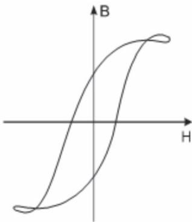  
图8磁滞回线图形的畸变

“ ”， 轴输入选择“ ”档，并选择合适的AC Y DC $R _ { 1 }$ 和 $R _ { 2 }$ 的阻值可得到最佳磁滞回线图形，避免出现这种畸变。

这样，在磁化电流变化的一个周期内，电子束的径迹描出一条完整的磁滞回线。适当调节示波器 和 轴增益，再由小到大调节信号发生器的输出电压，即能在屏上观察到由X Y小到大扩展的磁滞回线图形。逐次记录其正顶点的坐标，并在坐标纸上把它联成光滑的曲线，就得到样品的基本磁化曲线。

## 4、示波器的定标

从前面说明中可知从示波器上可以显示出待测材料的动态磁滞回线，但为了定量研究磁化曲线和磁滞回线，必须对示波器进行定标。即还须确定示波器的 轴的每格代表多少X值（ ）， 轴每格实际代表多少 。H A/m Y B(T)

一般示波器都有已知的 轴和 轴的灵敏度，可根据示波器的使用方法，结合实验使X Y用的仪器就可以对 轴和 轴分别进行定标，从而测量出 值和 值的大小。X Y H B

设 轴灵敏度为X $S _ { X } \big ( V / \sharp \sharp \big )$ ， 轴的灵敏度为Y $S _ { Y } \big ( V / \sharp \sharp \big )$ （上述 $S _ { \chi }$ 和 $S _ { Y }$ 均可从示波器的面板上直接读出），则：

$$
U _ {X} = S _ {X} \bullet X, U _ {Y} = S _ {Y} \bullet Y
$$

式中 ， 分别为测量时记录的坐标值（单位：格，即刻度尺上的一大格）X Y

由于本实验使用的 $R _ { 1 }$ , $R _ { 2 }$ 都是阻抗值已知的标准元件，误差很小，其中的和C $R _ { \mathrm { 1 } }$ , $R _ { 2 }$ 为无感交流电阻， 的介质损耗非常小。所以综合上述分析，本实验定量计算公式为：C

$$
H = \frac {N _ {1} \bullet S _ {X}}{L \bullet R _ {1}} \bullet X\tag{5}
$$

$$
B = \frac {R _ {2} \bullet C \bullet S _ {Y}}{N _ {2} \bullet S} \bullet Y\tag{6}
$$

式中各量的单位： $R _ { 1 } , R _ { 2 }$ 单位是 $\Omega$ ； 单位是 ； 单位是L m S $m ^ { 2 }$ ； 单位是C $F$ ；$S _ { \chi }$ , $S _ { Y }$ 单位是 ； ， 单位是格； 的单位是V/格 X Y H $A / m$ ； 的单位是B $T$ 。

## 【实验内容】

注意：实验前先熟悉实验的原理和仪器的构成。使用仪器前先将信号源输出幅度调节旋钮（多圈电位器）逆时针到底，使输出信号为最小。然后调节频率调节旋钮，因为频率较低时，负载阻抗较小，在信号源输出相同电压下负载电流较大，会引起采样电阻发热。

## 用显波器和FB310D型磁特性综合测量实验仪测定两种样品磁滞特性

1．按图5所示线路接线。

## 2．样品退磁

1）单调增加磁化电流，顺时针缓慢调节信号幅度旋钮，使示波器显示的磁滞回线上 值B增加变得缓慢，达到饱和。改变示波器上 、 输入增益和X Y $R _ { 1 }$ ， $\mathrm { R } _ { 2 }$ 的值，示波器显示典型美观的磁滞回线图形。磁化电流在水平方向上的读数为 $( - 5 . 0 0 , + 5 . 0 0 ) $ ）格，此后，保持示波器上 、 输入增益波段开关和X Y $R _ { \mathrm { 1 } }$ ， $\mathsf { R } _ { 2 }$ 值固定不变并锁定增益电位器（一般为顺时针到底），以便进行 、 的标定。H B

2）单调减小磁化电流，即缓慢逆时针调节幅度调节旋钮，直到示波器最后显示为一点，位于显示屏的中心，即 和 轴线的交点，如不在中间，可调节示波器的 和 位移旋钮。X Y X Y实验中可用示波器 、 输入的接地开关检查示波器的中心是否对准屏幕 、 坐标的交X Y X Y点。

3．按图中所标注的元件参数设置元件的参数值：

取样电阻： $R _ { 1 } = 2 . 5 \Omega$ ，积分电阻： $R _ { 2 } = 1 0 k \Omega$ ，积分电容： $C = 3 \mu F$

4．接通示波器和磁滞回线实验仪的工作电源；在无信号输入的情况下，把示波器的光点调节到坐标网格中心；

5．调节磁滞回线实验仪信号输出旋钮，并分别调节示波器 和 轴的灵敏度，使显示X Y屏上出现图形大小合适的磁滞回线。（若图形顶部出现编织状的小环，如图8所示，这时可降低励磁电压 予以消除）。记录曲线上各点对应的 、 坐标数值（电压值）。U X Y

6．观察基本磁化曲线：从 $U = 0$ 开始，逐渐提高励磁电压，可以在示波器显示屏上观察到面积由小到大一个套一个的一簇磁滞回线。这些磁滞回线顶点的连线就是样品的基本磁化曲线（如果用长余辉示波器，便可观察到这些曲线的轨迹），记录各顶点的位置坐标值和示波器 和 轴的灵敏度数值。X Y

7．根据选择的示波器的灵敏度和显示格数，可以计算 $U _ { \scriptscriptstyle 1 } , U _ { \scriptscriptstyle 2 }$ 的数值，再根据已知的元件参数即可以计算励磁电流和磁感应强度的数值。注意：示波器显示的电压值是峰峰值，而公式中用的电压值是有效值，它们的关系是： $U = U _ { \scriptscriptstyle P - P } / 2 \sqrt { 2 }$ 。

9．8．观察、比较样品 和样品 的磁化性能。1 2

令 $U = 3 . 0 V , \ R _ { 1 } = 3 . 0 \Omega$ 测定样品 的1 $B _ { { m } } , B _ { { r } } H _ { { C } }$ 和 $| B H _ { }$ 等参数。

10．取步骤7中的 和其相应的 值，用坐标纸绘制H B $B \sim H$ 曲线（如何取数?取多少组数据?自行考虑），并估算曲线所围面积。

11.注意事项：积分电阻不宜小于 ，积分电容不宜小于10kW $3 \mu F$ ，否则可能使磁滞回线图形发生崎变（如图8）。

## 【实验数据与数据处理】

表1 基本磁化曲线与 $\mu - H$ 曲线数据记录

<table><tr><td>U(V)</td><td> $U_x(V)$ </td><td> $U_y(V)$ </td><td>H (A/m)</td><td>B (mT)</td><td> $\mu = B/H(H/m)$ </td></tr><tr><td>0.5</td><td></td><td></td><td></td><td></td><td></td></tr><tr><td>1.0</td><td></td><td></td><td></td><td></td><td></td></tr><tr><td>1.2</td><td></td><td></td><td></td><td></td><td></td></tr><tr><td>1.5</td><td></td><td></td><td></td><td></td><td></td></tr><tr><td>1.8</td><td></td><td></td><td></td><td></td><td></td></tr><tr><td>2.0</td><td></td><td></td><td></td><td></td><td></td></tr><tr><td>2.2</td><td></td><td></td><td></td><td></td><td></td></tr><tr><td>2.5</td><td></td><td></td><td></td><td></td><td></td></tr><tr><td>2.8</td><td></td><td></td><td></td><td></td><td></td></tr><tr><td>3.0</td><td></td><td></td><td></td><td></td><td></td></tr></table>

表2 关系曲线实验数据记录B-H  
${ { H } _ { c } } =$ $B _ { r } =$ $B _ { { } _ { m } } =$ $[ B H ] =$

<table><tr><td>No</td><td> $U_x(V)$ </td><td> $U_y(V)$ </td><td>H (A/m)</td><td>B (mT)</td></tr><tr><td>1</td><td></td><td></td><td></td><td></td></tr><tr><td>2</td><td></td><td></td><td></td><td></td></tr><tr><td>3</td><td></td><td></td><td></td><td></td></tr><tr><td>4</td><td></td><td></td><td></td><td></td></tr><tr><td>5</td><td></td><td></td><td></td><td></td></tr><tr><td>......</td><td></td><td></td><td></td><td></td></tr><tr><td>17</td><td></td><td></td><td></td><td></td></tr><tr><td>18</td><td></td><td></td><td></td><td></td></tr><tr><td>19</td><td></td><td></td><td></td><td></td></tr><tr><td>20</td><td></td><td></td><td></td><td></td></tr></table>

## 二、磁性材料在交直流叠加磁化场时磁性能研究

软磁铁氧体材料作为电感器或变压器磁心的应用十分广泛。在电子电路中，往往要通过磁心绕组的偏流给固体电子器件建立一个适宜的工作点，以使其处于某一要求的工作状态。这种电路中提供一个直流偏压是常用的手段，在磁心绕组中则产生一个直流偏磁场，简称DC-BIAS。这就是为什么要分析交直流叠加磁滞回线的原因。

## 1. 不对称局部磁滞回线的产生

在正弦交流和直流同时励磁时产生的磁滞回线称为有直流偏磁的磁滞回线。在一个周期中，由于一段时间内磁心受到交，直流方向相同的正向励磁；另一段时间内因为交，直流方向相反受到反向励磁，因此出现的磁滞回线是局部不对称。如 图9所示，虚线表示仅在交流励磁时的磁滞回线，涂黑的部分是交，直流同时作用的结果，产生不对称局部磁滞

回线。理论与实验均可以发现，所加的直流分量越大，局部回线越小，不对称愈发明显。

## 2. 控制磁化曲线

当无直流磁场只有交变磁场作用 时，B～t曲线是对称的， 这时 $\Delta B = 2 B m$ ( 为 B 的Bm峰值) ，即 $B m = \Delta B / 2$ , 但在交直流叠加时B～t曲线的 正负峰值不等。 $B m = \Delta B / 2$ 的含义就不确 切 。 为 了 使 交 直 流 叠 加 的 磁 化 曲线与通常的无直流时的动态磁化曲线 容Bm-Hm易比较，一般都把前者的纵坐标轴用

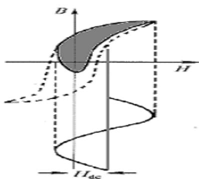

图 9

标定，写为DB/2 $\overline { { B m } }$ ，但要注意，在这里它代表的并非是正的峰值或负的峰值，而是正峰值到负峰值的一半。见图 10

实验发现，在此条件下动态回线的形状与偏置直流磁场强度的大小，交流磁场强度的幅值和频率均有关系，一般情况下来谈磁化强度是没有什么意义，因此我们所谈的磁化控制都是在确定交流偏磁的强度H稳定的基础上来分析

直流偏磁的大小对磁感应强度 的变化。DB

按其工作方式，控制磁化曲线可分为外反馈式（饱和电抗器式）和内反馈式（自饱和式）两大类。本实验采用外反馈式。在铁心上同时加有交流和直流的磁化场,（见图 13）。仿照铁心的实际使用状态，交流磁化强度 ，相对保持固定不变得，测量磁感应强度Hm变化量 $\Delta B = B _ { 1 } - B _ { 2 }$ 与偏置磁场强度 $H _ { b }$ 之间的关系曲线，就是外反馈式控制磁化曲线。图11A是外反馈式控制磁化曲线，型式上来说，外反馈式磁放大器不过是一种具有特殊组合方式的饱和电抗器，要测量 的

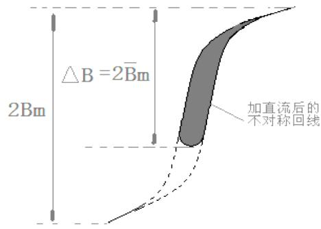  
图 10

## 曲线也不过是交直流叠加磁化曲线DB--Hb

的另一种表示形式。当 变化时，可有一簇Hm $\Delta B -- H b$ 曲线，见图 11。如图所示，当Hm逐渐降低时， 逐渐减少，在 低于某数值是，会成为曲线（1） 所示的形状。由2DB Hm曲线，可求得软磁

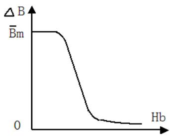

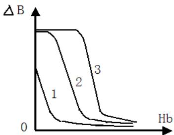  
图 11

## 3. 增量磁导率

在此磁场强度下，材料磁化已接近饱和，不会出现如曲线（1）所示的饱和不足，因而使铁心磁状态不稳定。也不会如图中曲线（3）中所示的过饱和，使消耗过多的功率。

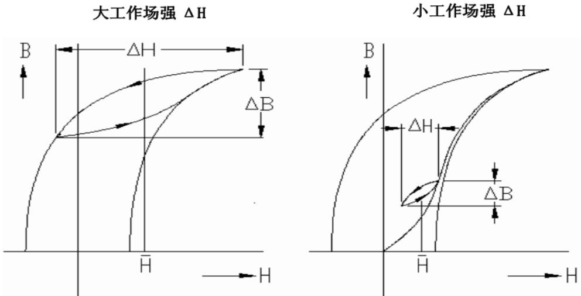  
直流磁场H叠加一个幅度为ΔH/2的交流磁场后的磁滞回线  
图:12

直流偏磁场的出现使磁心被磁化了，当交变磁场与直流磁场同时作用于磁心，则磁心处于交直流叠加结果，较低的交变场，由于场强振幅远低于矫顽力，所以产生的磁滞回线呈椭圆形。较高的交变场，随着场强幅度的高低，所产生的磁滞回线也随着工作点的变化而呈现不同倾斜状态，如图一所示。这些小磁滞回线的倾斜度可用它的平均斜率来计量，称作叠加磁导率，即增量磁导率 $\mu _ { \Delta }$ ，从图12中可看出：

$$
\mu_ {\Delta} = \frac {1}{\mu_ {0}} \frac {\Delta B}{\Delta H}
$$

公式中的 $\mu _ { 0 }$ 是真空磁导率。

## 4. 实验内容： 磁性材料在交直流叠加状态下，进行动态磁滞回线实验

## ⑴ 不对称磁滞回线的观察：

步骤：

1) 在完成常规的磁滞回线实验后，按图13所示接线，在N3加上直流激磁电源。

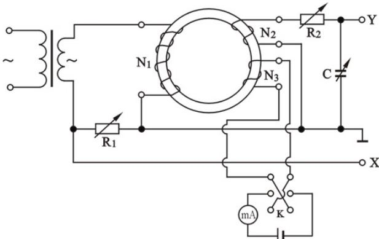  
图 13

2) 选择电键 K 方向，逐渐加大电流，观察不对称磁滞回线的产生，并在电流加大的情况下，变形的程度越发严重。（见图14）

3) 改变电键K的方向，观察反向的不对称磁滞回线。

⑵ 测量控制磁化曲线：

步骤：

1) 调节磁滞回线实验仪信号输出旋钮，并保持相对稳定，再分别调节示波器 和X轴的灵敏度，使显示屏上出现图形大小合适的磁滞回线。要求与前相同。Y

2) 按步率 $\Delta 5 0 \mathrm { { m a } }$ 调节调节直流电源,用 $H _ { b } = N I / L$ 的公式，算出每步的激磁$H _ { b 1 } , H _ { b 2 } , \dots$ ，测量出每步的 $\Delta B ( 2 \overbar { B } m )$ 。计算公式（5），（6）。

3) 用坐标纸绘制D $B \sim H _ { b }$ 曲线，（\* 的测量是正峰值到负峰值的数值差。）DB  
Hm = N3 = L =

<table><tr><td> $H_b = \frac{N_3I}{L}$ </td><td>B1</td><td>B2</td><td> $\overline{Bm} = \frac{\Delta B}{2}$ </td></tr><tr><td></td><td></td><td></td><td></td></tr><tr><td></td><td></td><td></td><td></td></tr><tr><td></td><td></td><td></td><td></td></tr><tr><td></td><td></td><td></td><td></td></tr><tr><td></td><td></td><td></td><td></td></tr></table>

⑶ 不同激磁下的增量磁导率 ${ \bf \nabla } \cdot { \bf \mu } _ { \Delta }$ 的测量：不作要求

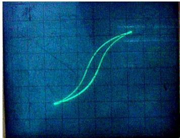  
（1）

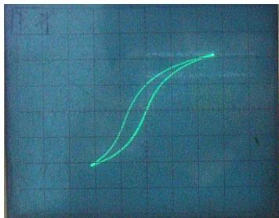

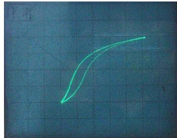  
（2）  
（3）

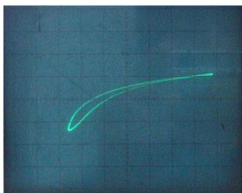  
（4）

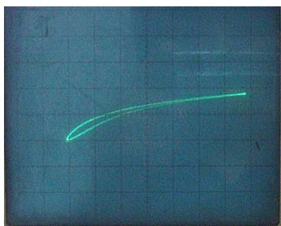  
（5）

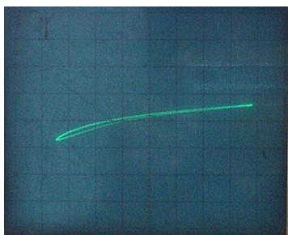  
（6）  
图14 （1）～（6）为不同直流偏置下的退化磁滞回线

## 【附录】

## FB310D型磁特性综合测量实验仪使用说明

## 一．实验仪主要功能：

磁滞回线实验仪,配合示波器可观察铁磁性材料的基本磁化曲线和磁滞回线。仪器由励磁电源、试样、面板以及实验接线图等部分组成。

## 二．结构和主要技术参数：

1．励磁电源：

由仪器本身的低频信号发生器产生正弦波信号：

（1）输出电压： $A C \quad 0 \sim 8 V _ { _ { P P } }$ 连续可调；

（2）信号频率： $2 5 \sim 2 0 0 H z$ 连续可调。

2．测试样品参数：

样品 ：环形铁氧体磁性材料1

$$
N _ {1} = N _ {2} = N _ {3} = 1 5 0 T, L = 0. 1 3 0 m, \mathrm{S} = 1. 2 4 \times 1 0 ^ {- 4} m ^ {2}
$$

样品2：EI型铁芯

$$
N _ {1} = N _ {2} = N _ {3} = 1 5 0 T, L = 6. 0 \times 1 0 ^ {- 2} m, S = 8. 0 \times 1 0 ^ {- 5} m ^ {2}
$$

3．仪器面板 ：

面板上装有待测样品 和样品 、励磁电源“ 选择”和测量励磁电流（即磁场强度 ）1 2 U H的取样电阻“ $\mathsf { R } _ { 1 }$ 选择”、以及为测量磁感应强度 所设定的积分电路元件B $\mathrm { R } _ { 2 } , \mathrm { C } _ { 2 }$ 等。

4. 磁化电流采样电阻 $\mathsf { R } _ { 1 }$ ：二位电阻盘： $( 0 \sim 1 0 ) \times ( 1 + 0 . 1 ) \Omega \quad S T E P \ 0 . 1 \Omega$

5. 积分电阻 $\mathsf { R } _ { 2 }$ ：二位电阻盘： $( 0 \sim 1 0 ) \times ( 1 0 + 1 ) k \Omega \ S T E P \ 1 k \Omega$ ；

6. 积分电容 ：二位电容盘：C $( 0 \sim 1 0 ) \times ( 1 + 0 . 1 ) \mu F ~ { S T E P } ~ 0 . 1 \mu F$

7. 工作电源：交流市电 $2 2 0 V \pm 1 0 \%$

8. 外形尺寸： $3 3 0 \times 2 3 0 \times 1 2 0 m m$

9. 重量：≤8kg。

## 三、其它说明

1．以上各元器件（除电源开关）均已通过面板与其对应的插孔连接，只需采用专用导线，便可实现电路连接。

2．此外，设有电压 $U _ { B }$ （正比于磁感应强度 的信号电压）和B $U _ { H }$ （正比于磁场强度 的H信号电压）的输出插孔，用以连接示波器，观察磁滞回线波形。

3．连线时注意 线要连通。GND

4．为了保证示波器的量程是准确的，必须使量程微调旋钮处于校正位置。只有这样，才能根据示波器显示的格数、选择的灵敏度（量程），代入公式计算 值。H和B