## **铁磁材料的磁滞回线和基本磁化曲线实验**

浙江大学  物理实验教学中心

1

目录 CONTENTS

**实验背景**

**EXPERIMENT BACKGROUNDS**

**1**

**实验目的**

**EXPERIMENT OBJECTIVE**

**2**

**实验原理**

**EXPERIMENT PRINCIPLE**

**3**

**4**

**实验内容**

**EXPERIMENT CONTENT**

**5**

**实验思考**

**EXPERIMENT INSPIRATION**

**2**

1

## **实验背景**

EXPERIMENT BACKGROUNDS

## **1**

## **实验背景**

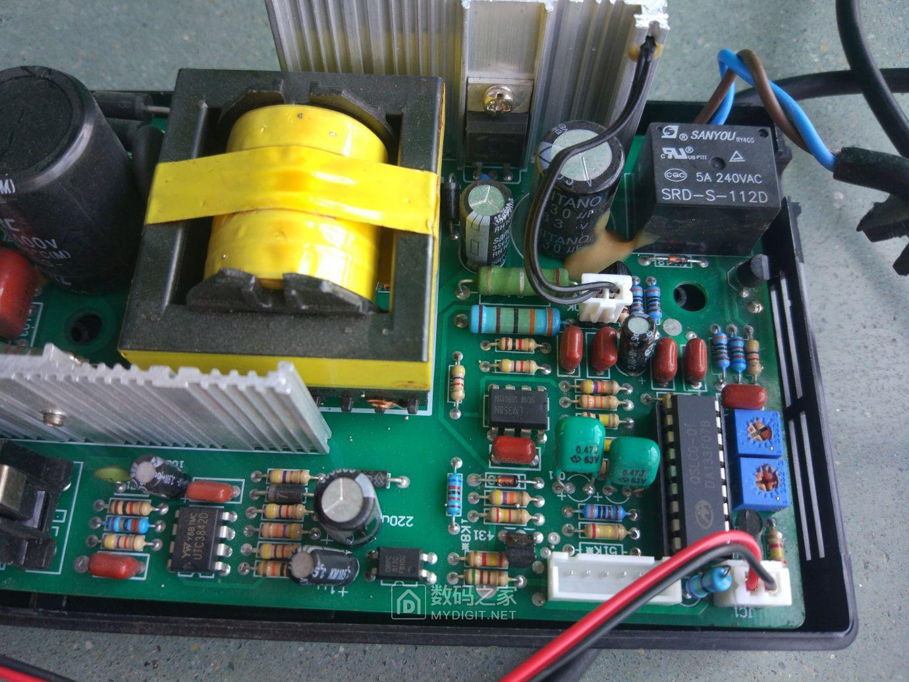

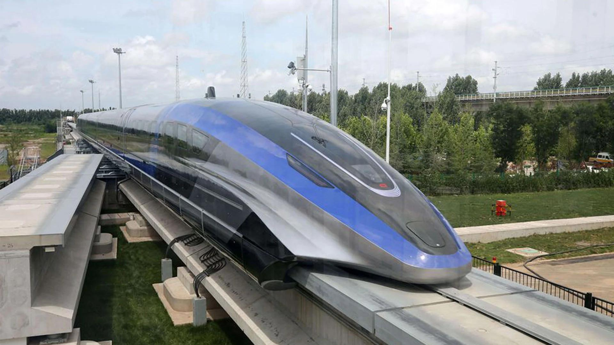

**能源交通**

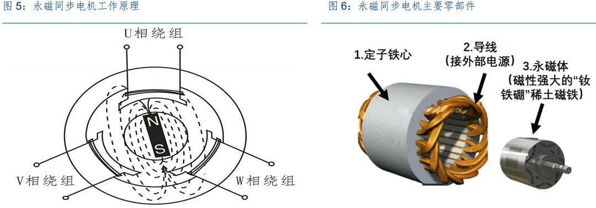

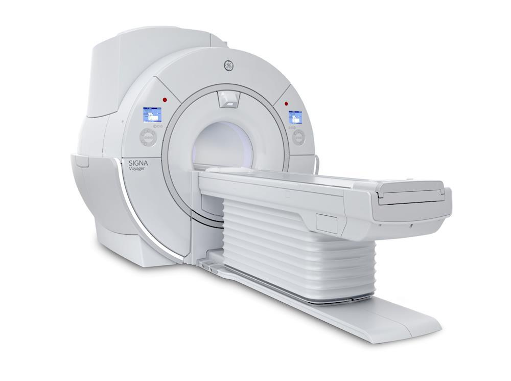

中国各类磁性材料的整体产量位居世界第一！

**4**

## **1**

## **实验背景**

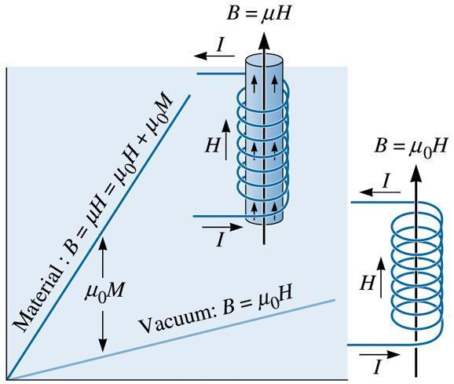

**材料磁化**

- 对磁场的的认识源于通电导线

**磁场强度** $：\boldsymbol{\mathit{H}}=\frac{\boldsymbol{\mathit{n}}\boldsymbol{\mathit{I}}}{\boldsymbol{\mathit{l}}}$ （单位：A/m）

励磁电流（ $I）$ 、匝数（ $n$ ）、磁路长度（ $l$ ）

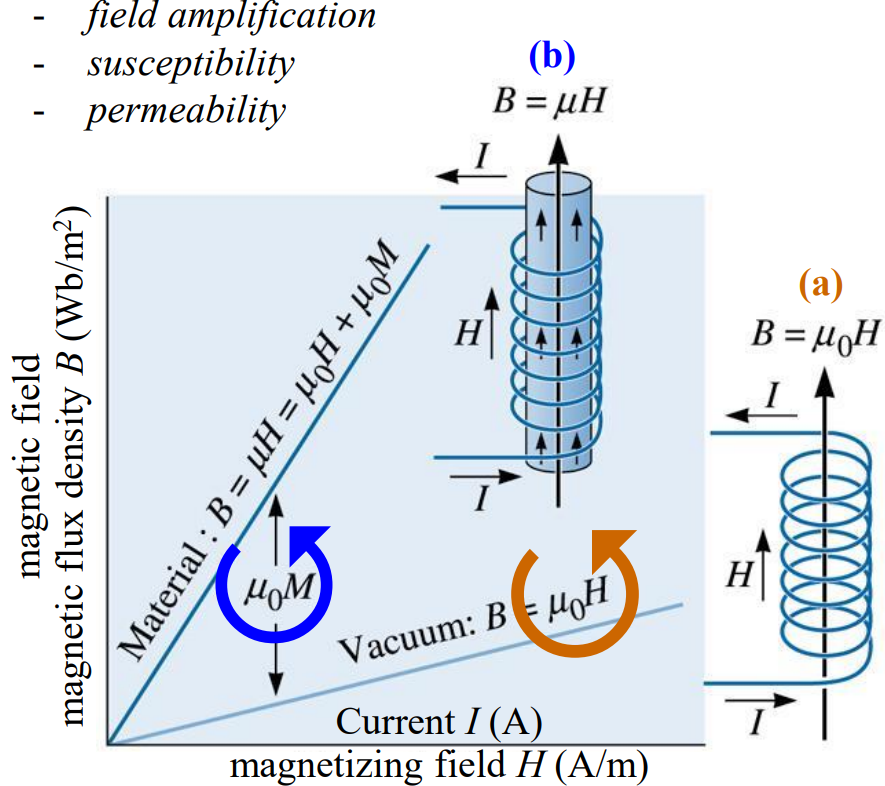

**励磁电流**

- 带电粒子在磁场中的受力运动:           $F=q\vec{v}\times \vec{B }$

**磁感应强度：** $\boldsymbol{\mathit{B}}=\frac{𝝓}{\boldsymbol{\mathit{S}}}$ （磁通面密度，单位：T）

### $𝝁=\frac{\boldsymbol{\mathit{B}}}{\boldsymbol{\mathit{H}}}$

### <em><strong>B</strong></em> <strong></strong><em><strong>H</strong></em> <strong>=</strong><em><strong></strong></em><strong>0(</strong><em><strong>H</strong></em><strong>+</strong><em><strong>M</strong></em><strong>)=</strong><em><strong></strong></em><strong>0 (1</strong> <em><strong></strong></em> <strong>)</strong><em><strong>H</strong></em>

铁磁材料 $𝝁\gg 𝝁_{\mathbf{0}}$

$\mu _{0}$ ：真空磁导率

$M:$ 介质的磁化强度

$\chi : 磁化$ 率

**磁导率**

$𝝁=𝝁_{\mathbf{0}}\left(\mathbf{1}+𝝌\right)=𝝁_{\mathbf{0}}𝝁_{r}$

### **5**

2

## **实验目的**

EXPERIMENT OBJECTIVE

## **2**

## **实验目的**

- **了解采用示波器测动态磁滞回线的原理，学会用示波器测绘基本磁化曲线和磁滞回线。**
- <strong>掌握磁滞、磁滞回线和磁化曲线的基本概念，测量材料的饱和磁感应强度</strong><em><strong>Bs</strong></em><strong>，剩磁</strong><em><strong>Br</strong></em><strong>，矫顽力</strong><em><strong>Hc</strong></em><strong>的数值。</strong>
- <strong>深刻理解物理实验中的<u>转换法</u>。</strong>

**7**

3

## **实验原理**

EXPERIMENT PRINCIPLE

## **3**

## **实验原理**

**磁畴理论（Magnetic Domain Theory）**

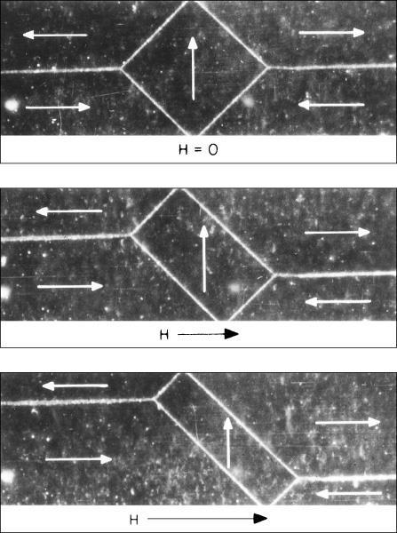

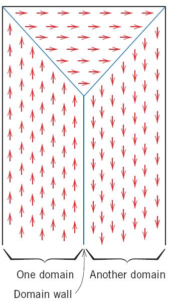

- **不同取向磁化区域：磁畴**
- **磁畴-磁畴边界：畴壁**

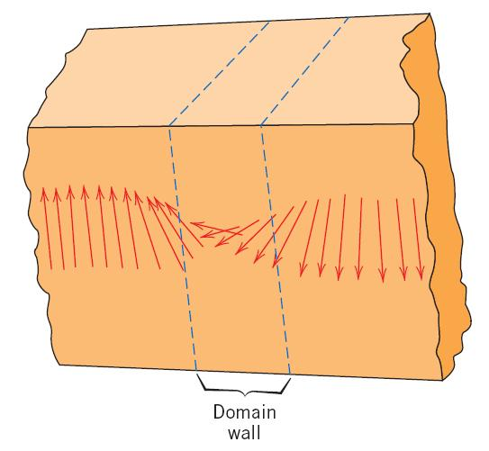

Magnetic domain structure in a  single crystals of Fe-3%Si alloy photomicrographs

**9**

## **3**

## **实验原理**

### **3.1 铁磁材料的磁化**

- <strong><u>不同取向的自发磁化区域：磁畴</u></strong>
- <strong><u>磁化过程：磁畴旋转和畴壁迁移</u></strong>

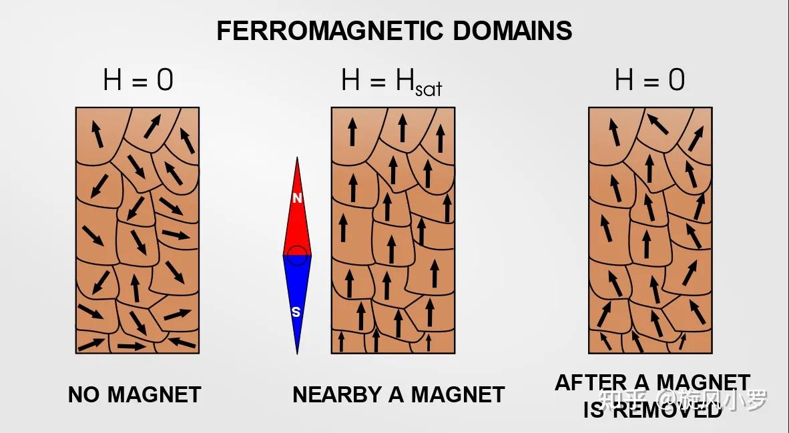

Fe、Co、Ni和其它铁磁合金等

*B*

*B*S

0

$B$ *-H*

$s$

$\mu$ *-H*

磁化曲线

*B*m

*H*

**10**

## **3**

## **实验原理**

### **3.2 铁磁材料的磁滞回线**

**Os：初始磁化曲线**

<em><strong>B</strong></em><strong>S  ：饱和磁感应强度</strong>

<em><strong>B</strong></em><strong>r  ：剩余磁感应强度</strong>

<em><strong>H</strong></em><strong>c ：矫顽力</strong>

<u>磁滞</u>：<em>B</em>的变化总是落后于<em>H</em>的变化

<u>磁滞损耗</u><em>BH</em>：能量损失与磁滞回线包围的面积成正比

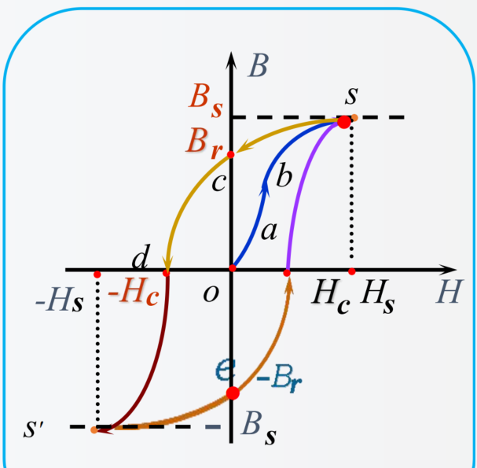

**磁化→去磁→反向磁化→反向去磁**

**11**

## **3**

## **实验原理**

### **动态法测量铁磁材料的磁化曲线**

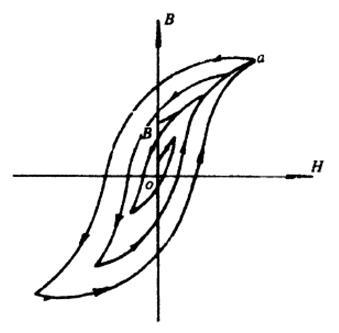

*B*

*B*S

$s$

$B$ *-H*

$\mu$ *-H*

0

*B*m

*H*

磁化曲线

交变励磁电流产生正负变化的H

**12**

## **3**

## **实验原理**

### **3.3 不同铁磁材料的磁滞回线**

**硬磁材料**

**“胖”**

### **磁滞损耗**

**软磁材料**

**“瘦”**

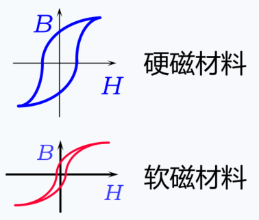

<strong>高剩磁</strong><em><strong>B</strong></em><strong>r</strong>

<strong>高矫顽力</strong><em><strong>H</strong></em><strong>c</strong>

～104-106A/m

电表、扬声器内永磁体

**高磁导率** $\mu$

<strong>低剩磁</strong><em><strong>B</strong></em><strong>r</strong>

<strong>低矫顽力</strong><em><strong>H</strong></em><strong>c</strong>

～100A/m

反复磁化去磁：

继电器、变压器、电动机的铁芯

**13**

### **3**

## **实验原理**

<strong>3.4示波器显示</strong><em><strong>B</strong></em><strong>-</strong><em><strong>H</strong></em><strong>曲线的原理</strong>

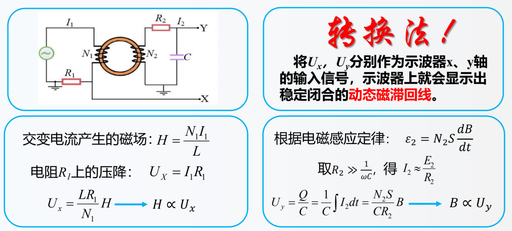

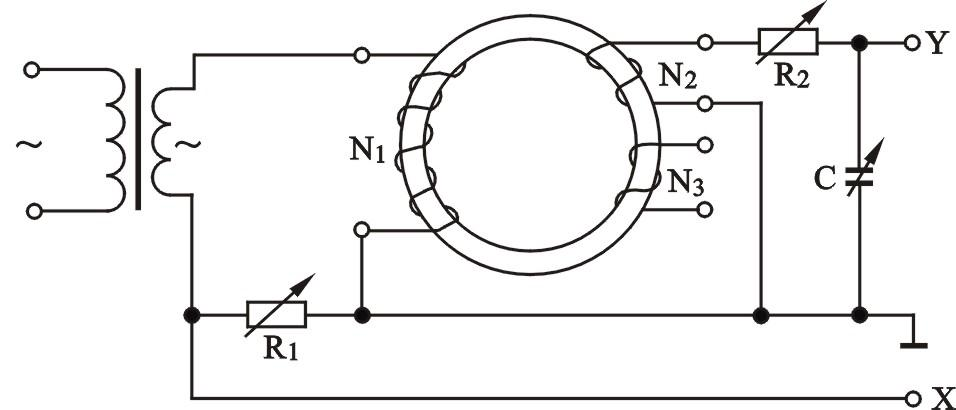

积分电路

$I_{2}=\frac{\epsilon _{2}}{Z}=\frac{\epsilon _{2}}{R_{2}+{1}/{\omega c}}  → \approx \frac{\epsilon _{2}}{R_{2}}$

将*U*x、*U*y分别作为接入示波器x轴、y轴的输入信号，显示稳定的动态磁滞回线

- $H=\frac{N_{1}}{LR_{1}}U_{x}$
- $B=\frac{R_{2}C}{N_{2}S}U_{y}$

## **转换法！**

## **3**

## **实验原理**

示波器能将电压信号以 波形（正弦波、 方波、锯齿波） 显示在荧光屏 上。它由示波管、 放大器（包括 X 轴放大和 Y 轴 放大）、扫描与触发同步系统和电源四个基本部分组成。

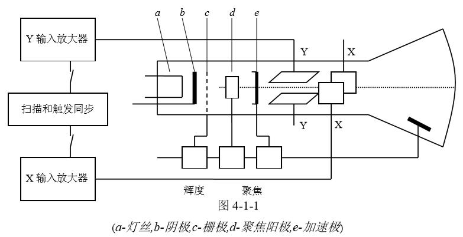

X-ch1信号输入

Y-ch2信号输入

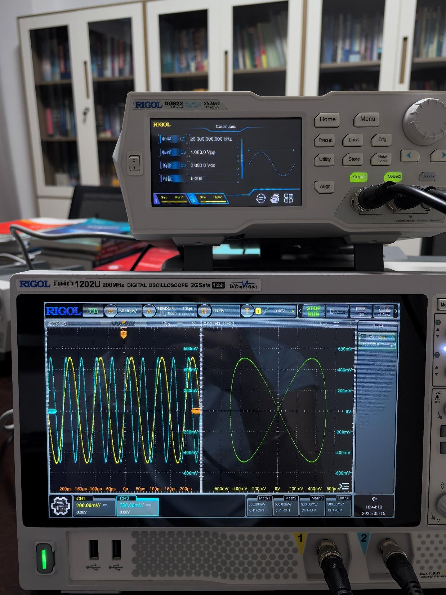

X-Y模式的李萨如图

**15**

4

## **实验内容**

EXPERIMENT CONTENT

## **4**

## **实验内容**

- 按图示连接样品1，设置电阻值*R*1=2.5Ω、*R*2=10kΩ、*C*=3µF，交流励磁频率设置130Hz。
- 调节示波器为X-Y模式，将交流励磁信号的电压单调上升至3.5V，调节X-Y放大增益（Volt-div旋钮）使磁滞回线完整显示并尽可能占据更大的屏幕面积。微调电子束聚焦、亮度等显示。
- 将交流励磁电压单调下降至0V，进行退磁，并调节电子束光斑至屏幕中心。（position旋钮）

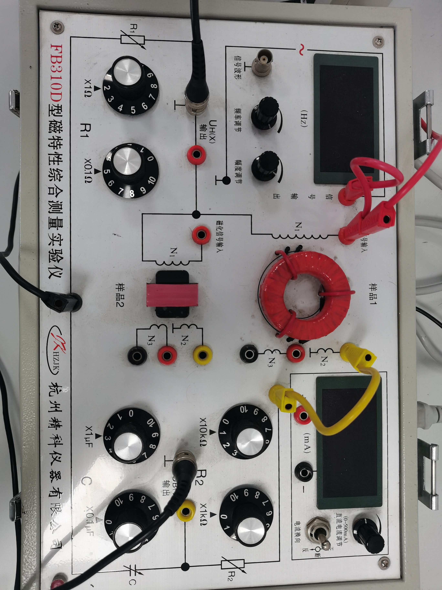

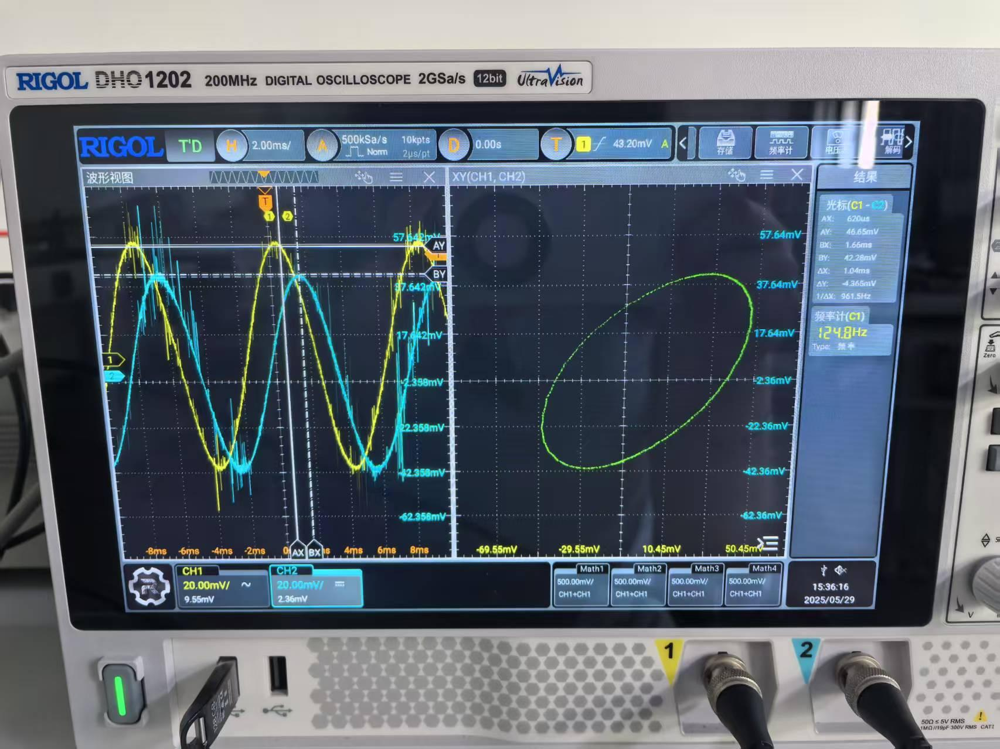

**直流励磁信号**

**交流励磁信号**

**接地**

## **4**

## **实验内容**

### **4.1 初始磁化曲线的测量**

以0.5V的间隔增加交流励磁电压直至3V，示波器光标读出磁滞曲线的端点电压的峰值坐标

<strong>(</strong><em><strong>Ux</strong></em><strong>,</strong> <em><strong>Uy</strong></em> <strong>)</strong>

根据公式计算对应的 $(H,B,\mu )$

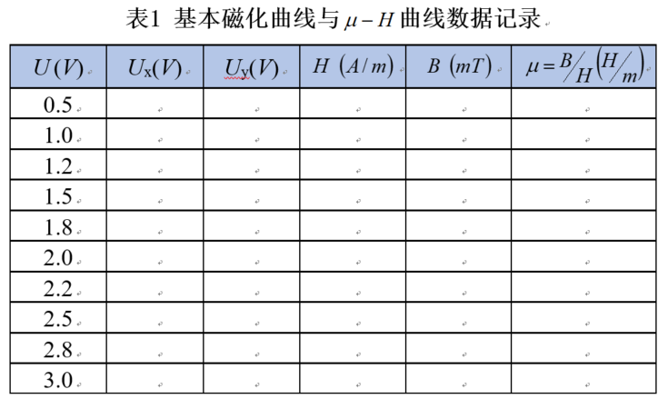

Uy

Ux

- $H=\frac{N_{1}}{LR_{1}}U_{x}$
- $B=\frac{R_{2}C}{N_{2}S}U_{y}$

**注意量纲转换！**

### **18**

## **4**

## **实验内容**

### **4.2 动态磁滞回线的测量**

保持励磁电压为3V。利用光标逐点读出饱和状态磁滞回线上各点的电压的值(*U*x, *U*y) 计算 $(H,B)$

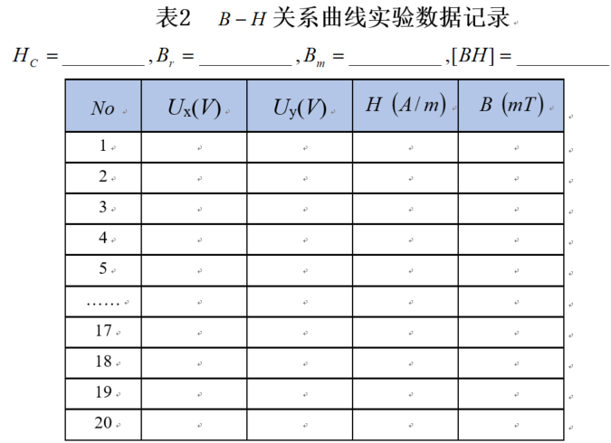

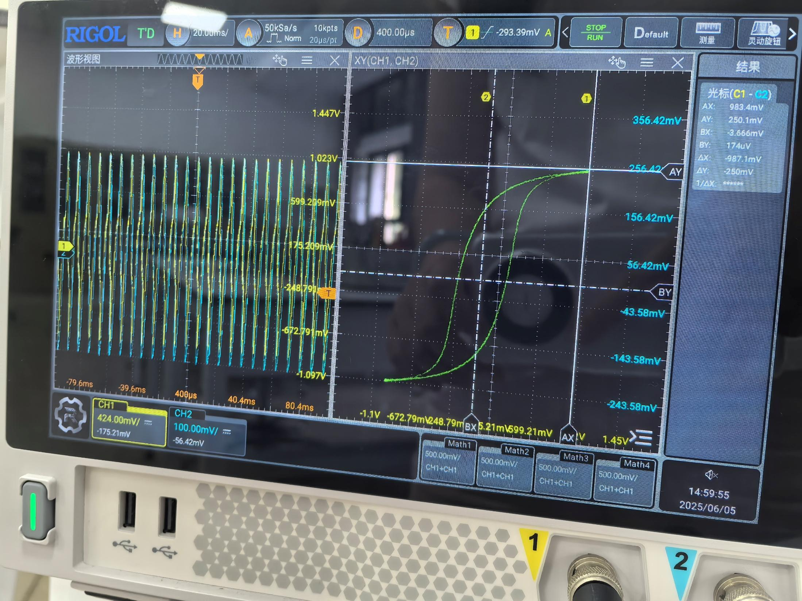

Uy

Ux

- $H=\frac{N_{1}}{LR_{1}}U_{x}   B=\frac{R_{2}C}{N_{2}S}U_{y}$
- 样品1 铁芯参数N1=N2=N3=150，L = 0.130 m，S = 1.24 × 10-4m2

### **19**

## **数据处理示范：Origin软件教程**

磁化曲线Origin软件绘图示例：double-Y

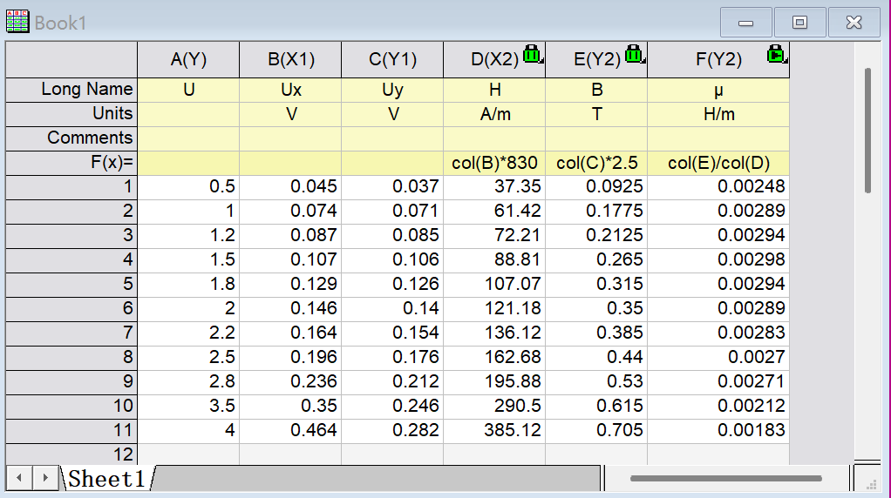

**设置为X\Y\Y**

**选中该三列数据后右键**

**编辑公式**

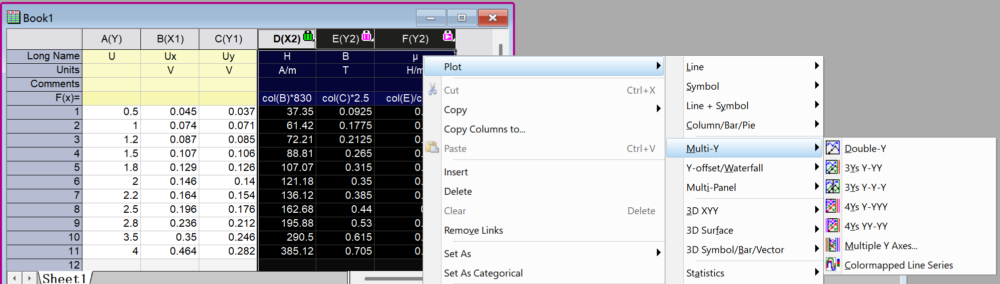

**20**

## **绘制双Y轴磁化曲线图**

图1.磁化曲线图。

作图规范：

- *物理量*（单位）
- 坐标轴：粗细、间隔、数值
- 图号.图表名称

斜体

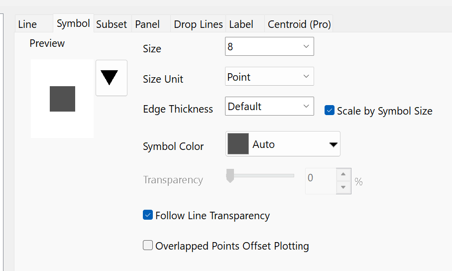

**双击数据点（坐标轴）可更改线的粗细等绘图参数**

**21**

## **磁滞回线图中特殊点的坐标标记**

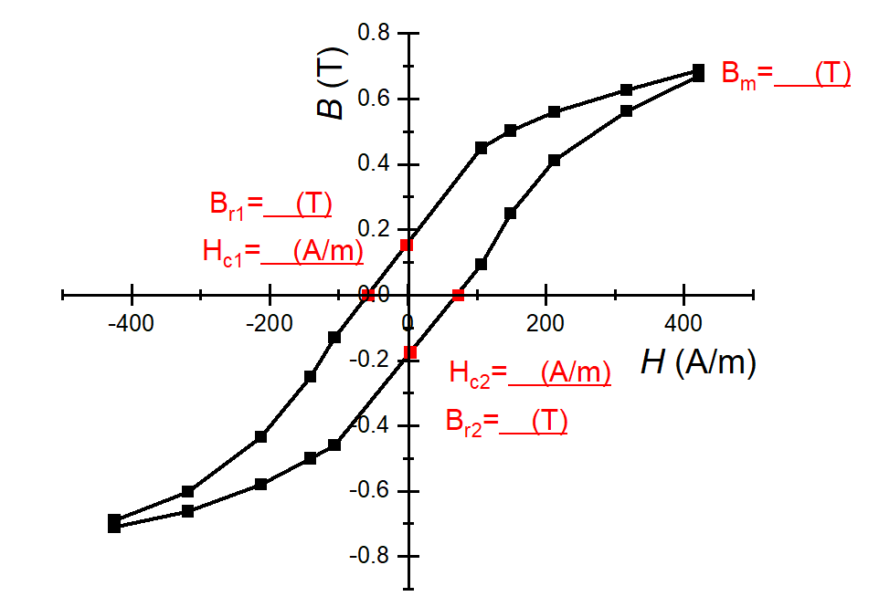

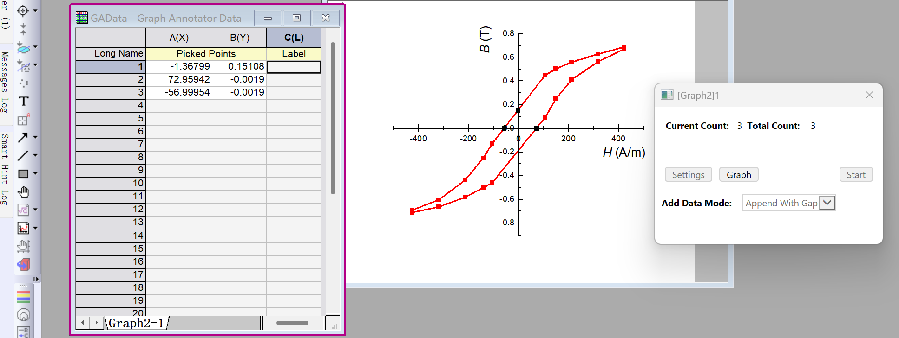

自由绘点的坐标：标记坐标轴的交点

求得Hr、Br、Bm的值。

图2. 磁滞回线图。由该数据可知，样品<em>B</em>r1=______(T) ， <em>B</em>r2 =_____ (T)，<em>H</em>c1= ______( A/m)， <em>H</em>c2= ______( A/m)， BH= ______ (?)。

**22**

## **使用Origin求闭合曲线包围的面积（方法一）**

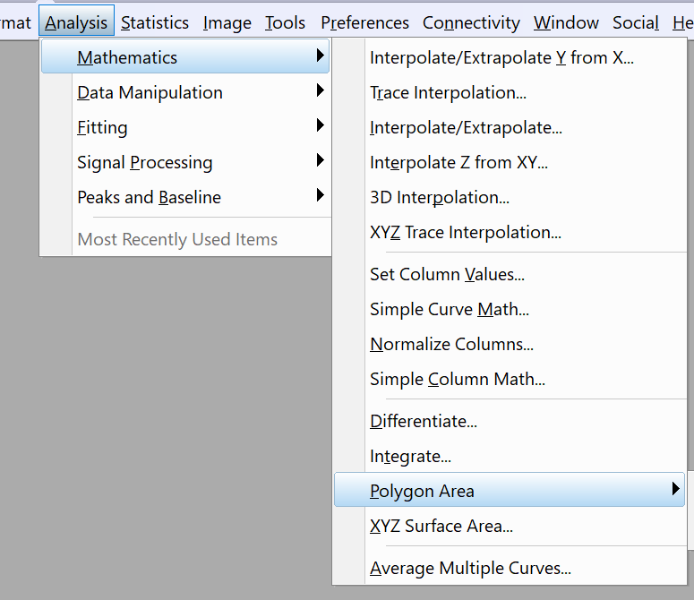

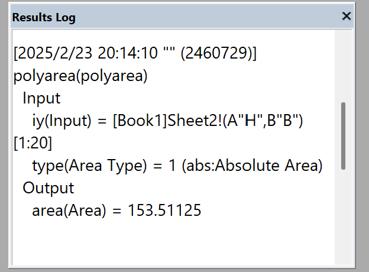

选中数据点，Analysis-Mathematics-Polygon Area

求曲线包围的面积，计算BH= ______ (?)

推导：BH单位是多少？

**23**

## **使用Origin求闭合曲线包围的面积（方法二）**

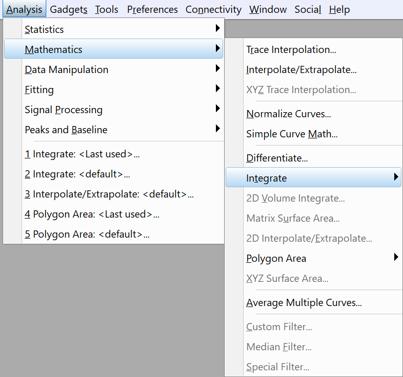

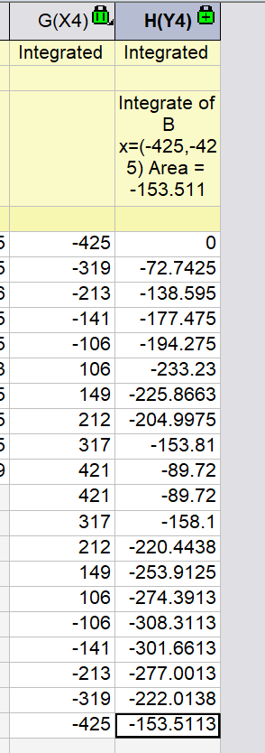

选中数据点，Analysis-Mathematics-Integrate

数值积分的方法求得闭合曲线包围的面积

注意：表格中数据点的顺序

**24**

5

## **实验思考**

EXPERIMENT INSPIRATION

## **5**

## **实验思考**

**思考题：**

1. $B\bullet H$ （磁能积）的单位是否与能量能关？请给出量纲的推导过程。
2. 查阅有关资料，简要回答积分电路的原理与有关应用。
3. 磁性材料内部的涡流损耗的能量是否可以被利用起来？请列出应用实例。

**26**

**5**

## **实验思考**

**2023年韩国室温常压超导的乌龙：LK99!**

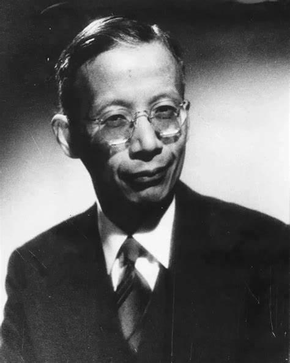

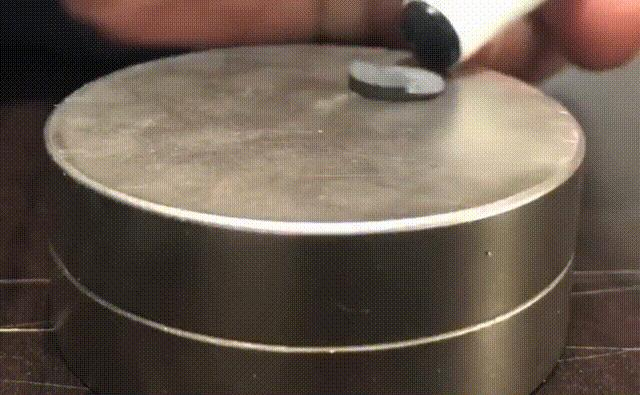

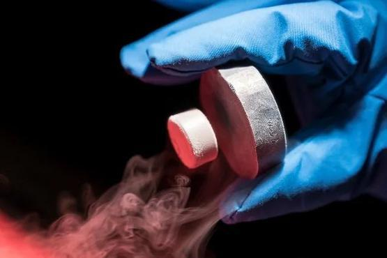

## **求是创新**

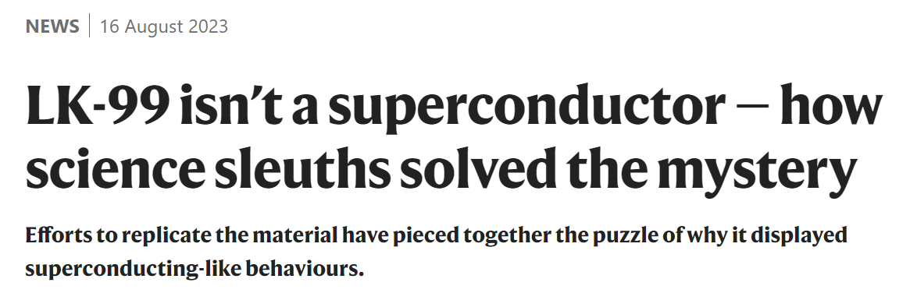

**27**

谢    谢!

28

2025/7/10